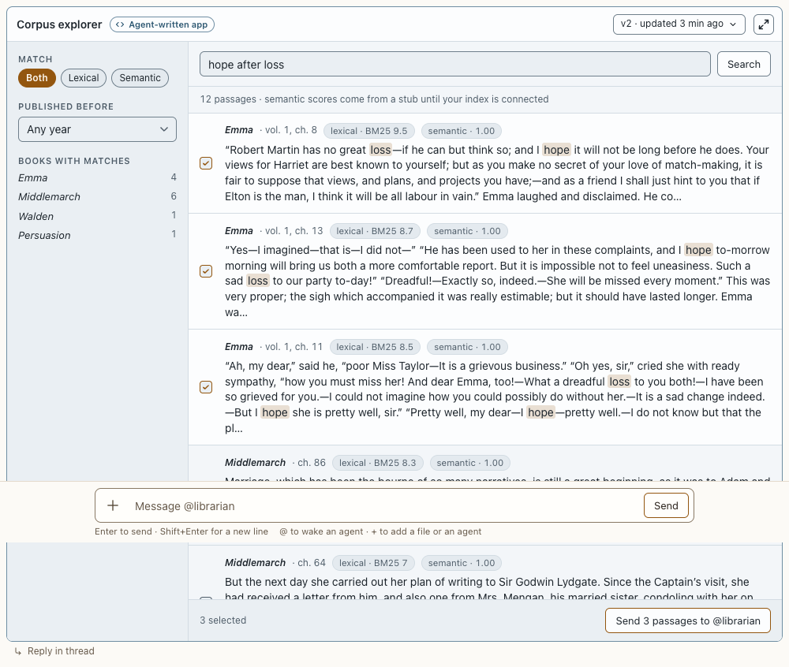

# Agent-written app

**Where:** Inline in replies, full conversation width.

## Why it exists

Agents write software when it explains better than prose; it must run safely and look like part of Postbox.

## Expected functionality

- Runs sandboxed (opaque origin, no network) on the cool app stage, labeled “Agent-written app”.
- Named like any other message: when the speaker changes, the app has its own speaker line (ring, @name, time) in the message column. Only the agent that wrote an app can update it, so that’s also who made each version (#88).
- Checked at 375 and 1280 px before you see it; a failed check goes back to the agent once, then shows with a note.
- The check also finds text that spills out of its own box (`text-overflow`: “a long description…” is 256 px wide in a 207 px box) and text drawn over other text (`text-overlap`), which stay inside the page, so the page-level overflow test missed them (#194). Text over text counts only when it’s there twice, about a second apart; text hidden with opacity 0, under something opaque such as a sticky footer, cut off by its own box, or in KaTeX math doesn’t count, and a line set tight counts only its line’s height. Text in a box that scrolls sideways can be scrolled to, so it isn’t overflow, nor is a badge positioned past a button’s corner. A check that fails says so as a note, and isn’t sent to the agent. Animation frames run on a timer in the hidden check frames, so a d3 transition finishes there as it does on screen.
- The check also finds controls you can’t see or click (`control-hidden`, #89): a button, link or field with no size, cut to under half of it (or under 8 px across) by an ancestor whose overflow isn’t visible, or under another element at its middle. The message names what clips or covers it, and when the clipping class is one of Postbox’s own (an app’s `class="bar"` became a 4 px progress bar), it says so and suggests a prefix. A scroll box you can scroll in doesn’t count as clipping. Controls hidden on purpose don’t count: under an open modal dialog, cut away entirely (a carousel’s other slides, a closed accordion), collapsed to no size (a menu at scale(0)), a custom checkbox’s or radio’s input, or a field hidden for screen readers. A nearly transparent element over a control, such as a watermark, is reported with pointer-events: none as the fix. The guide lists the classes an app may use on purpose and says to prefix its own.
- The check also measures legibility: SVG marks under 4 px, text under 9 px, dashes too fine to tell from solid lines, and an app that shows only an error or missing-data message. These are warnings: the app is shown “with notes for @agent”, and the agent is told in its lint turn.
- Version menu ([screenshot](../../screenshots/app-version-menu.png)) shows older versions read-only.
- **A new version follows the conversation** (#49): `update_app` brings the app to the newest point, beside the agent’s note about the change, so it’s in view without scrolling when you’re at the bottom. Its old place becomes one line, “Pair explorer · updated to v2 below”, with Go to it. It’s the same app, not a copy: one frame runs, and its saved state and version menu carry over. Scrolled up, what you’re reading doesn’t move; if you were reading the app itself, its line takes its place. An app that’s already the newest item just updates.
- **Retiring an app** (#193): an agent retires an app it showed that’s wrong, replaced or no longer needed with `retire_app`, rather than a version that only points elsewhere. The app stays where it was, as one quiet line: “Practice lab · Retired by @researcher: The metro map covers the same route.”, with “Go to Metro map” when `replacedBy` names an app or block shown in the conversation, and its version menu. It runs no sandbox, and isn’t checked. A version you open from the menu shows read-only, the current one too, and Close puts the line back. Only the agent that showed the app can retire it (from a topic thread too, since it answers there from the same session, #228), and a new version (`update_app`) brings it back at the newest point. Retiring drops sends waiting on the app’s card (“Not sent: Practice lab was retired.”), and the app can’t send again. In an app review, a retired app shows read-only.
- **Full screen** ([screenshot](../../screenshots/app-fullscreen.png)) fills the window with the app, in place: the same frame, so it doesn’t reload and keeps what you were doing. Focus moves to the button, now “Exit full screen”, and Tab stays inside. Escape (on the page, or inside the app unless the app uses Escape itself) or the button brings it back to the column, with focus on the button, at the height its content now needs (up to the column’s cap). The version menu works while full screen. Leaving the conversation ends full screen: coming back shows the app in the column.
- A crash shows a card with Reload and Ask to fix ([screenshot](../../screenshots/app-crashed.png)).
- Saved state survives reloads; saving never reloads the frame.
- **Large apps and data go by file** (#54): an agent can send an app’s code as `codePath`, a file in its folder, and attach up to 8 data files (20 MB each) that the app reads with `postbox.file(name)`. Postbox reads them itself, only from the agent’s folders (a link can’t lead outside), under the same limits, and keeps a copy with that version, so a later edit to the file doesn’t change it. A tool call needs the agent’s running turn’s token: a script posting to `/mcp` with the session id alone is refused, and nothing shows.
- **Data to search goes into the corpus** (#47): an agent writes JSON Lines to the project’s `.postbox/datasets/` and loads it with `add_dataset`, and its app reads it with `corpus.read` and `corpus.search` at once, with no restart. The conversation shows “@researcher loaded the dataset scifact · 5,183 records, searched only when named”. A search that doesn’t name the dataset in `books` doesn’t get it, and it’s loaded again after a restart.
- Postbox writes the line in your voice from what the app sent, never from the app’s words (#51): “Sent from Pair explorer: send_pairs · pairs: 200 items · 14 KB”. The app’s summary shows beside it as “The app’s summary: …”, and agents read it marked as the app’s words, apart from what Postbox counted. A summary that claims 1,258 pairs beside “pairs: 200 items” shows the difference.
- An app’s `postbox.send` (a line in your voice, and an agent turn) counts only right after you click or press a key in that app. A send on load or on a timer is refused, and the app gets the reason. Up to 5 a minute go straight through; more wait on the [app send card](../harness-cards/app-send-card.md). A send over 64 KB of JSON rejects inside the app with an error that names the limit and says to send ids instead, and nothing reaches the conversation.
- An app gets the keyboard only when you click it or Tab into it. An app that moves focus into itself gives it straight back (your typing stays in the composer) and can’t send until you click or Tab into it; one that keeps doing it is stopped, with a card to reload it. An app takes clicks once Postbox sees the pointer over it: when the pointer moves onto it, or when the app moves under a resting pointer (scrolling, a reply streaming in, a message landing above). An app that moves away from the pointer stops taking clicks. Known limit: a click whose press lands in the same instant the pointer arrives, with no rest in between, goes to the page and has to be repeated. Hands always rest for a moment; automated clicks, including the Claude desktop browser pane’s, may not.
- Works in the Claude desktop browser pane.

## Steps to reproduce

1. Run the demo (`node tools/demo.mjs --port 4180`) and open <http://127.0.0.1:4180/> while it plays; keep the tab open.
2. In “Corpus explorer”, search, pick passages, send them; switch to v1 and back. Press Full screen, use the app, switch versions, then press Escape; do it again and close it with the button, by keyboard.
3. Reload the page and check the app restores its state.
4. Run `npx playwright test app-fullscreen` (`tests/browser/app-fullscreen.spec.mjs`): the frame fills at least 90% of the window without reloading, Escape brings it back with focus on the button, an app that grew comes back taller, an app’s own Escape stays in the app, and full screen ends when you leave the conversation.
5. Run `npx playwright test follow` (`tests/browser/follow.spec.mjs`): an updated app shows at the bottom, in view, with one frame and a stub where it was; scrolled up, the message you’re reading stays put; reading the app, its stub holds the place, and Go to it leads to the app.
6. Run `node tools/checks/app-files.mjs`: an app shown from codePath reads its data file in the sandbox, a file it doesn’t carry rejects, a raw POST to `/mcp` with only the session id is refused, a loaded dataset shows its line and reaches an app with no restart (but not an unnamed search), and Settings offers no session-id endpoint.
7. Run `npx playwright test app-send` (`tests/browser/app-send.spec.mjs`): an app that sends on load is refused, a click or Enter in it sends, your line says what it sent with the app’s summary apart, and a frame that grabs focus can’t send.
8. Run `node tools/check-contract.mjs`: a hand-off of 1,258 items with their text rejects inside the app, naming the 64 KB limit, and the same hand-off by id goes through.
9. Run `npx playwright test app-retire`: a retired app becomes its line with no frame and moves nothing, its link scrolls to the replacement and moves focus there, a version opens read-only and Close brings the line back with focus on its menu, an app retired before its check finishes stays an unchecked line, the lines survive a reload, and a new version brings the app back.
10. Run `node tools/checks/app-check.mjs`: nowrap text in a fixed column, and the “Eight visual forms” gallery’s v1, get `text-overflow` and `text-overlap`; the gallery’s v2, labels a transition moves into place, a tooltip hidden with opacity 0, a list under its sticky footer and ordinary text set tight pass. A row of buttons in `class="bar"`, and a button under an overlay, get `control-hidden`; buttons in a scroll box and a checkbox hidden for screen readers don’t. KaTeX math, a figure set tight over its caption, a `<pre>` that scrolls sideways, a badge past a corner, sixty stacked opaque cards, controls hidden on purpose and the kit’s 8-column heatmap pass.
11. For the legibility warnings, run `npx playwright test feedback` (`tests/browser/feedback.spec.mjs`): it shows a chart too small to read, a readable one, and an app with only an error.

**Pass if:** The app works, versions switch, a new version shows at the bottom with one line where it was, a retired app is one line that leads to its replacement, state restores, the frame doesn’t reload on its own or when it goes full screen, no line appears in your voice that you didn’t click or type for, and only the unreadable apps get notes.

## Related

- [charts](charts.md)
- [narration player](narration-player.md)
- [app send card](../harness-cards/app-send-card.md)
