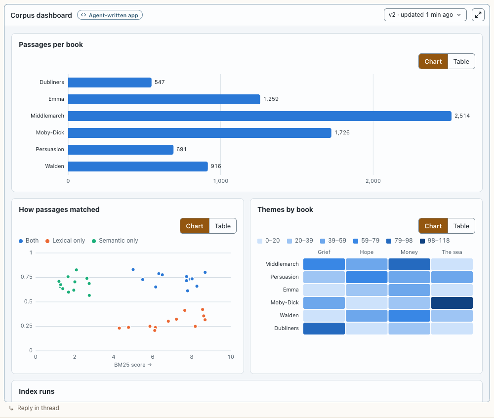

# Kit charts

**Where:** Inside agent apps (postbox.charts).

## Why it exists

Charts built to the design rules, each readable as a table too.

## Expected functionality

- Line, scatter, stacked, heatmap and table, with a Chart/Table toggle, legends, and light/dark tokens.

## Steps to reproduce

1. Run the demo (`node tools/demo.mjs --port 4180`) and open <http://127.0.0.1:4180/> while it plays; keep the tab open.
2. In “Corpus dashboard”, toggle each chart to Table and back; switch theme.

**Pass if:** Each chart has a working table view and redraws in the other theme.
