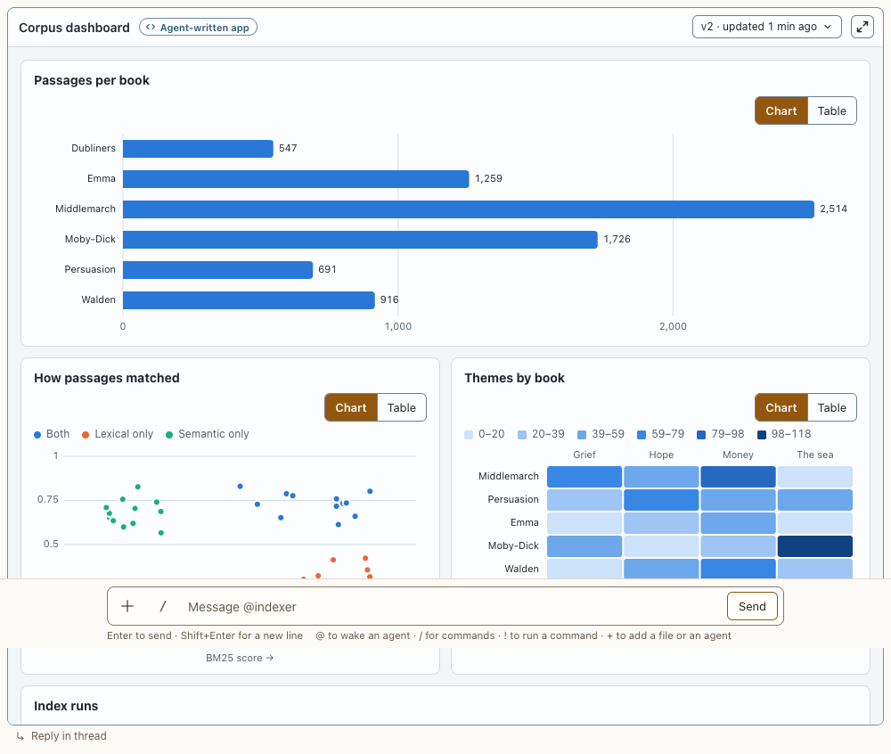

# Kit charts

**Where:** Inside agent apps (postbox.charts).

## Why it exists

Charts built to the design rules, each readable as a table too.

## Expected functionality

- Line, scatter, stacked, heatmap and table, with a Chart/Table toggle, legends, and light/dark tokens.
- The demo’s “Asset dashboard” draws four of them: a stacked chart of one series (passages per asset, so it reads as bars), a scatter, a heatmap and a table (`server/mock/apps.mjs`). A line chart needs an app that draws one.

## Steps to reproduce

1. Run the demo (`node tools/demo.mjs --port 4180`) and open <http://127.0.0.1:4180/> while it plays; keep the tab open.
2. In “Asset dashboard”, toggle each chart to Table and back; switch theme.
3. Long labels: `npx playwright test kit-chart-labels` draws a stacked chart, a heatmap and a line chart with long names, dates and a label far too long for any chart, at 375 and 1280 px.

**Pass if:** Each chart has a working table view and redraws in the other theme. In step 3, every label is inside its chart: a stacked chart’s or heatmap’s category labels get the room they need, up to half the chart, and a line chart’s series names and x labels the room they take; a longer one ends in “…” on a whole character, with its full name in a title, and the table view names every one.
