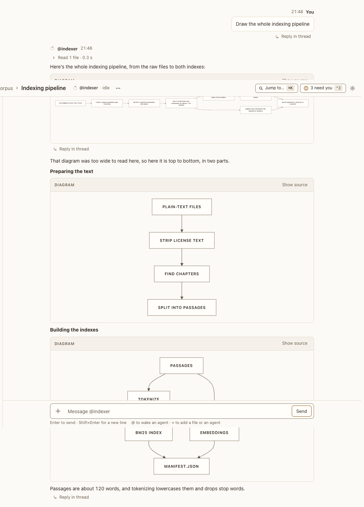

# Diagram legibility lint

**Where:** Agent replies with diagrams too wide to read.

## Why it exists

A wide diagram shrinks until its text can’t be read; the agent should redraw it.

## Expected functionality

- Postbox estimates each diagram’s text size and tells the agent when it’s under 10 px; the browser also measures rendered diagrams.
- Postbox also tells the agent when a diagram couldn’t be drawn at all, with Mermaid’s message and line.
- Everything one reply caused (undefined terms, diagrams, app warnings) reaches the agent in one lint turn.
- The agent replies with a corrected diagram; the redraw isn’t linted again.

## Steps to reproduce

1. Run the demo (`node tools/demo.mjs --port 4180`) and open <http://127.0.0.1:4180/> while it plays; keep the tab open.
2. Scene 11b, “Indexing pipeline”: the first diagram is too wide; the redraw follows.

**Pass if:** The redrawn diagrams are legible at 13 px.
