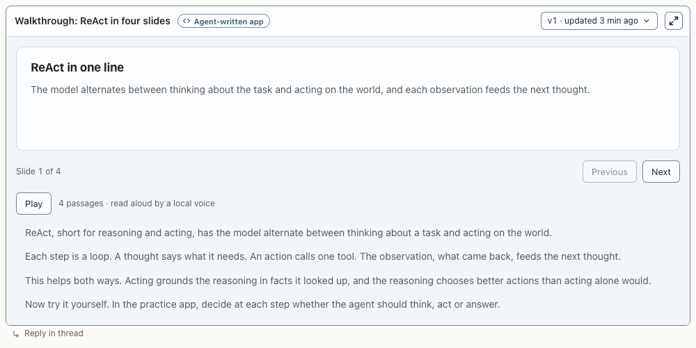

# Narration player

**Where:** Inside agent apps (postbox.narration).

## Why it exists

Walkthroughs read aloud with a local voice, with the transcript always on screen.

## Expected functionality

- Play/Pause; the passage being read is marked and the slide follows; any passage can be clicked to start there.
- Without the voice, it says so and the transcript still reads.

## Steps to reproduce

1. Run the demo (`node tools/demo.mjs --port 4180`) and open <http://127.0.0.1:4180/> while it plays; keep the tab open.
2. In “ReAct, out loud”, press Play (first use downloads the voice), then click passage 3.

**Pass if:** Audio plays passage by passage and the slides follow.
