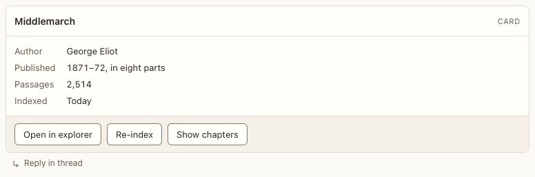

# Card block

**Where:** Agent replies summarizing one thing.

## Why it exists

Facts at a glance with up to three actions.

## Expected functionality

- Body, facts list and up to three action buttons; actions don’t lock the card.

## Steps to reproduce

1. Run the demo (`node tools/demo.mjs --port 4180`) and open <http://127.0.0.1:4180/> while it plays; keep the tab open.
2. In “Catalog tour”, press a card action.

**Pass if:** The action reaches the agent.
