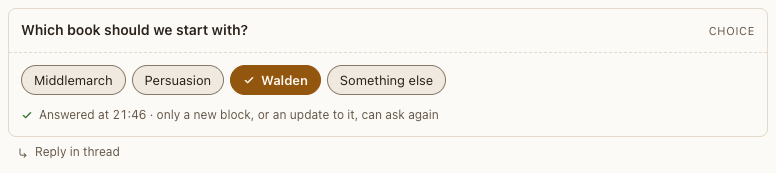

# Choice block

**Where:** Agent replies that ask a question with set answers.

## Why it exists

Fixed answers are faster and less ambiguous than typing.

## Expected functionality

- Single or multiple choice (chips or buttons), optional “other” text, a max.
- Answering sends one event to the agent, shows a line in your voice and turns the block read-only.
- A result the agent reports on it shows as a line under your answer, and the block stays answered (as on a [confirm](confirm.md)).
- Keyboard: arrows, Space/Enter; number keys pick options.

## Steps to reproduce

1. Run the demo (`node tools/demo.mjs --port 4180`) and open <http://127.0.0.1:4180/> while it plays; keep the tab open.
2. In “Catalog tour”, answer the choice with the keyboard only.

**Pass if:** The answer arrives as one event and the block locks.
