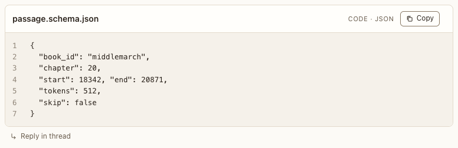

# Code block

**Where:** Agent replies with code.

## Why it exists

Code you can copy, with its filename and language.

## Expected functionality

- Syntax-highlighted code with filename, language and a Copy button.
- The filename shows in the header: as the title when the block has none, or beside the title (#41).
- Keywords, strings, numbers, called functions and comments are colored in JavaScript, TypeScript, JSON, Python, shell, SQL and the C family (C, C++, C#, Java, Go, Rust, Kotlin, Swift). Any other language shows as plain text.

## Steps to reproduce

1. Run the demo (`node tools/demo.mjs --port 4180`) and open <http://127.0.0.1:4180/> while it plays; keep the tab open.
2. In “Catalog tour”, find the code block and read its header.
3. Press Copy.

**Pass if:** The header reads “passage.schema.json” and “Code · JSON”, the keys and numbers are colored, and after Copy the code is on the clipboard and a confirmation shows.
