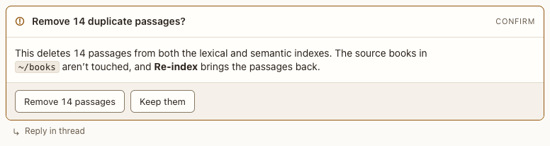

# Confirm block

**Where:** Before destructive or costly agent actions.

## Why it exists

You must see exactly what will happen before agreeing.

## Expected functionality

- States the consequence; the confirm button says the action (“Remove 14 passages”), not “OK”.
- Answering locks the block.
- When the agent reports what it did (“Done: 23 frames deleted”), the result shows as a line under your answer, in Markdown. The block stays answered, with no button to press again, and the agent doesn’t need you. The question stays as you answered it. Only an update without a result asks again.
- **Asking again follows the conversation** (#92): when the agent updates a confirm, choice, form or review so it asks again, the block comes to the newest point, beside the agent’s note, and its old place becomes one line, “Video frames deleted · asked again below”, with Go to it. It’s the same block: you answer it once, and the agent gets one event. ⌃J and the agent’s “needs you” lead to it. A result under your answer, and progress, card, table, code and image blocks, update where they are.

## Steps to reproduce

1. Run the demo (`node tools/demo.mjs --port 4180`) and open <http://127.0.0.1:4180/> while it plays; keep the tab open.
2. In “Catalog tour”, confirm or cancel.
3. Run `node tools/check-contract.mjs`: it confirms a block, has the agent report the result, and checks the line under the answer, the locked block and that nobody is asked again.
4. Run `node tools/checks/follow.mjs`: an answered confirm that’s asked again shows at the bottom, in view, with a line where it was; ⌃J goes to it, and answering records one answer for the new revision.

**Pass if:** Your answer reaches the agent and the block locks, a reported result shows under your answer without reopening it, and a block asked again shows at the bottom.
