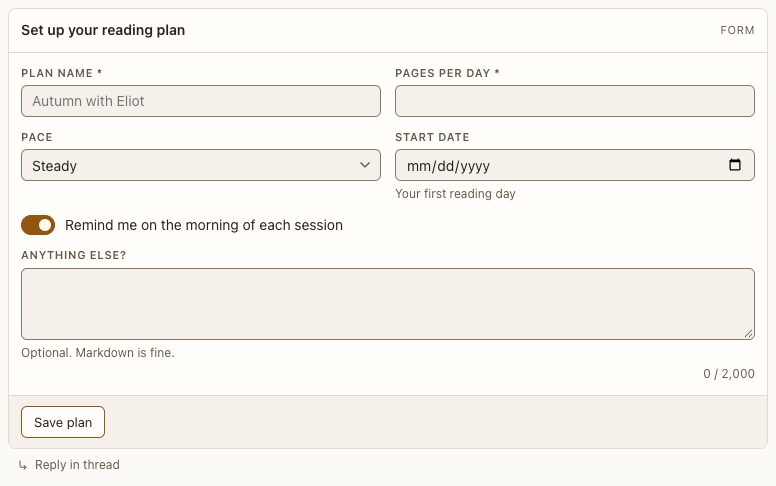

# Form block

**Where:** Agent replies that need several values.

## Why it exists

Collects structured input in one step, checked before it’s sent.

## Expected functionality

- Text, long text, number, select, toggle and date fields with labels and help.
- A select’s option with a description (#838) reads “Label — description” in the list.
- A number field with a min or a max shows its range under it before you submit, as a sentence in the words its error uses: “From 5 to 200.”, “At least 5.” or “No more than 200.” (#822). The input is described by it, and the agent’s own help and placeholder still show.
- In dark mode, a toggle that’s on has an amber outline and an amber knob on its usual track, not a solid amber fill (#181). Light mode keeps its fill.
- Invalid input shows a message under the field and doesn’t send; valid input sends numbers as numbers and dates as YYYY-MM-DD.
- While it waits on you, it can be dismissed, and its agent can withdraw it, as a [choice](choice.md) can (#106). A result the agent reports shows under your answer.

## Steps to reproduce

1. Run the demo (`node tools/demo.mjs --port 4180`) and open <http://127.0.0.1:4180/> while it plays; keep the tab open.
2. In “Catalog tour”, look under “Pages per day” before you submit, then submit the form with an out-of-range number, then fix it.

**Pass if:** “From 5 to 200.” shows under the field before you submit, the error appears under the field and says “Enter a number from 5 to 200.”, and the fixed form sends once.
