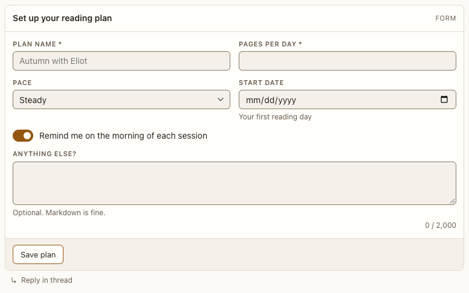

# Form block

**Where:** Agent replies that need several values.

## Why it exists

Collects structured input in one step, checked before it’s sent.

## Expected functionality

- Text, long text, number, select, toggle and date fields with labels and help.
- A toggle that’s on has an amber outline and an amber knob on its usual track, not a solid amber fill (#181).
- Invalid input shows a message under the field and doesn’t send; valid input sends numbers as numbers and dates as YYYY-MM-DD.
- While it waits on you, it can be dismissed, and its agent can withdraw it, as a [choice](choice.md) can (#106). A result the agent reports shows under your answer.

## Steps to reproduce

1. Run the demo (`node tools/demo.mjs --port 4180`) and open <http://127.0.0.1:4180/> while it plays; keep the tab open.
2. In “Catalog tour”, submit the form with an out-of-range number, then fix it.

**Pass if:** The error appears under the field, and the fixed form sends once.
