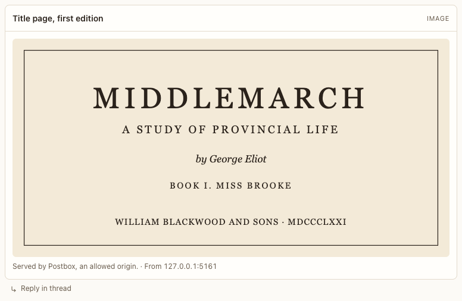

# Image block

**Where:** Agent replies with an image.

## Why it exists

Images from allowed origins only, always with alt text.

## Expected functionality

- Shows the image with its caption; alt text required; images from disallowed origins are rejected and the fallback is shown.
- Postbox’s own media loads whether you opened Postbox at `127.0.0.1:<port>` or at `localhost:<port>` (#180).
- An image that doesn’t load (missing, or blocked) shows “This image couldn’t load. It shows: …” with its alt text, in place of a broken-image icon.

## Steps to reproduce

1. Run the demo (`node tools/demo.mjs --port 4180`) and open <http://127.0.0.1:4180/> while it plays; keep the tab open.
2. In “Catalog tour”, check the image and its alt text.

**Pass if:** The image renders with alt text.
