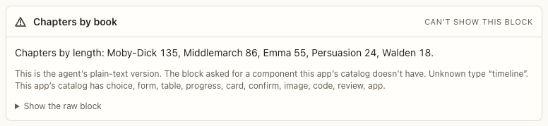

# Invalid block fallback

**Where:** Wherever an agent sends a block Postbox can’t show.

## Why it exists

A bad block must never break the transcript or fail silently.

## Expected functionality

- Shows the agent’s plain-text fallback, “Can’t show this block”, and a collapsed Show the raw block with the reason.

## Steps to reproduce

1. Run the demo (`node tools/demo.mjs --port 4180`) and open <http://127.0.0.1:4180/> while it plays; keep the tab open.
2. Open “Index the shelf” after scene 8 and expand Show the raw block.

**Pass if:** The fallback and the raw JSON with its errors are shown.
