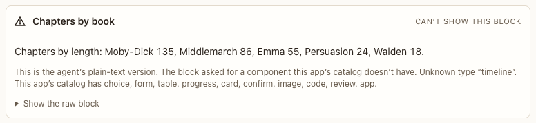

# Invalid block fallback

**Where:** Wherever a block Postbox can’t show reaches the conversation. Since #1319 that is only a block from an agent on a host, which the host’s newer catalog took but this Postbox can’t read: its type isn’t in this Postbox’s catalog, or its version is newer than this Postbox reads (`server/block-show.mjs`). Any other invalid block an agent sends is refused outright: the agent is told why and nothing is posted, so it can fix the block and send it again. A conversation from before #1319 still shows the fallbacks it held.

## Why it exists

A bad block must never break the transcript or fail silently.

## Expected functionality

- Shows the agent’s plain-text fallback, “Can’t show this block”, and a collapsed Show the raw block with the reason.
- Once the person opens the raw block, an update to its recorded errors keeps it open (#488).

## Steps to reproduce

1. Run the demo (`node tools/demo.mjs --port 4180`) and open <http://127.0.0.1:4180/> while it plays; keep the tab open.
2. Open “Index the shelf” after scene 8 (“Show it as a timeline”). @indexer’s timeline and progress blocks are invalid, so they’re refused: only its reply, “Here’s the timeline:”, is posted, with no card for the blocks.
3. The fallback itself needs an agent on a host whose Postbox is newer, sending a block of a type this one doesn’t know; the demo has no such host. Run `npx playwright test activity-state block-refusal`: `tests/browser/activity-state.spec.mjs` posts an unknown-type block’s fallback and keeps its raw block open across an update (#488), and `tests/browser/block-refusal.spec.mjs` checks that a malformed block leaves no card.

**Pass if:** In step 2 no broken card shows. Where the fallback does show, it has the agent’s plain-text version, “Can’t show this block”, and the raw JSON with the reason under Show the raw block. Both specs pass.
