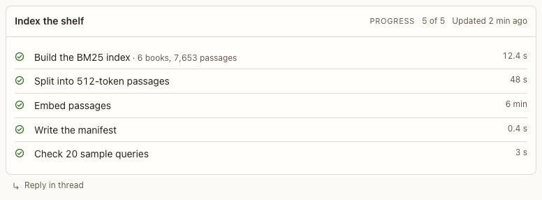

# Progress block

**Where:** Long jobs.

## Why it exists

Shows where a long job is without new messages.

## Expected functionality

- Steps with pending, running, done and failed states, detail and duration; updated in place as the agent moves on.
- A step with a count shows “2 of 4 papers” with a thin bar (or a percent), and an estimate such as “3 min left” while it runs.
- The header says when the block last changed (“Updated 40 s ago”), and a running step’s time counts up live.
- The running glyph turns; with reduced motion it holds still.
- A step left running when its agent’s turn ends is marked stalled: a pause glyph, dimmed, “No update for 2 min”, and the agent is told to close it. That holds when you stop the agent, or its turn fails, too (#98): no live clock keeps running, and the agent hears about the step at the start of its next turn, without a turn of its own. A step still marked running while its agent isn’t working looks the same after a minute without updates.
- Finished steps show how long they took, from Postbox’s own times when the agent didn’t say.

## Steps to reproduce

1. Run the demo (`node tools/demo.mjs --port 4180`) and open <http://127.0.0.1:4180/> while it plays; keep the tab open.
2. Watch “Index the shelf” in “Corpus planning”.

3. For counts, live times and a stalled step, run `npx playwright test feedback` (`tests/browser/feedback.spec.mjs`) (with `SHOTS=<folder>` for screenshots).

**Pass if:** Steps update in place, no copies are added, counts and times show, and a step left running looks stalled.
