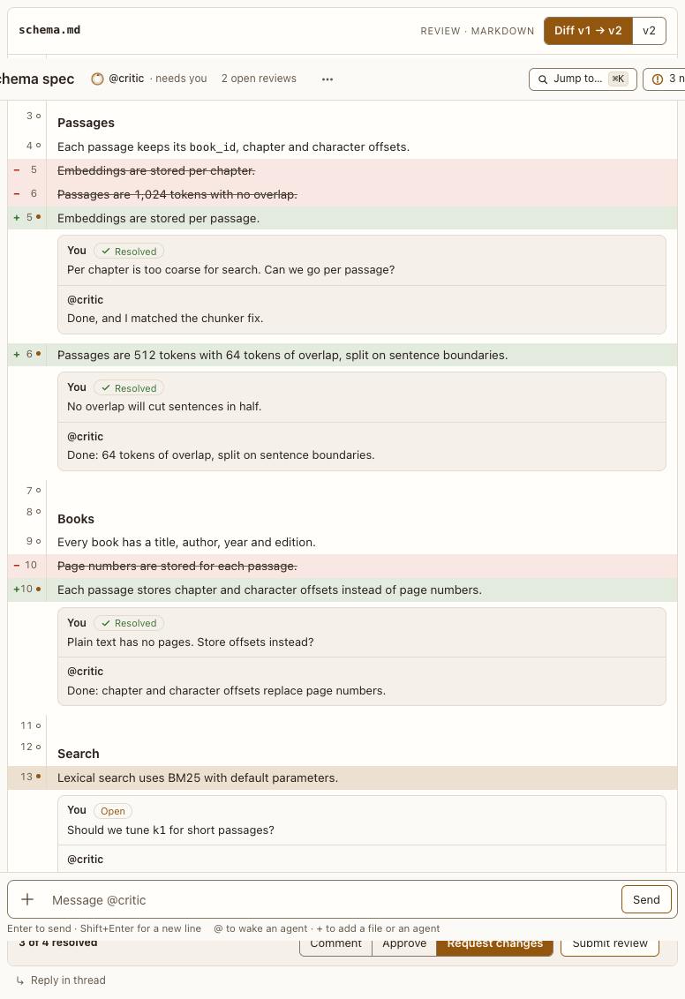

# Review block

**Where:** Review of a draft (Markdown, read in Preview and commented on by selection or by line), code (line by line) or an app.

## Why it exists

Feedback on long documents needs to be anchored to lines, batched, and followed by a visible revision.

## Expected functionality

- A Markdown draft has **Preview** and **Lines** in its bar (#179). It opens in Preview, or in Lines when a revision’s changes are there to read. The choice is kept for that revision of the block, across a reload, and switches from the keyboard with focus kept on it.
- At wide widths, Preview’s paragraphs, list items and comment threads fill the review’s content width for detailed feedback; conversation messages keep their 72-character reading measure. Narrow layouts are unchanged (#486).
- Preview draws the whole draft as a reply would: headings, lists, tables, Mermaid diagrams and math, in light and dark themes. Each thread and draft comment shows after the part of the draft it’s on.
- In Preview, selecting text shows a **Comment** button beside the selection. Tab reaches it from the selection, and Enter opens its comment box; adding the comment (or Escape) puts focus back on the text, selected again. The comment quotes the text, which stays marked in Preview, and sits on its line in Lines. A diagram, display math or an image can’t be selected inside: a click on one opens Lines at its lines, with their comment box. A click on text stays in Preview.
- The agent gets each comment on a selection as its line, columns and quote (“line 12, col 5–23 “the quoted text”: the comment”), in its event, its history and `read_message`. After it revises the draft, a draft comment whose quote is still there stays on it; one whose quote is gone says “Its text changed”.
- Another agent can review the draft too (`review_block`, #133). Its comments show on their lines, or on the text they quote, with its handle; the review bar says so (“2 comments from @critic (Request changes)”), and its agent hears them and can revise. A revision keeps them, resolved or open. The block still waits on you: only your answer approves it.
- The block takes the transcript’s width, past the reading column, with its prose at a readable measure. Full screen (the icon in its bar) fills the window; Escape or the same button, now “Exit full screen”, closes it, with focus back on it.
- Each line is its own comment target: click it, or Tab to it and press Enter, to open its comment box. A dim mark in the gutter (the line number and a dot, filled once the line has comments) shows every line takes one, without hovering. Screen readers hear “Comment on line 12”.
- Closing a comment box (Add draft comment, Cancel or Escape) puts focus back on its line.
- In Lines, Markdown renders by block, the way it does in a reply: a table is a table, a list keeps its numbering and nesting, a code fence is code and a quote is quoted. Each table row, list item and code line takes its own comment; a table’s delimiter row and a fence’s markers don’t show. A Mermaid or `$$` math fence is drawn whole, with one comment target for its lines; a diff that changed it shows its source.
- A Markdown image (``) shows as the image, from Postbox’s own media (at `127.0.0.1` or `localhost`) or an origin Postbox allows. One that can’t load, comes from another origin or has no full https address says “This image couldn’t load” in its place, with its alt text (#218).
- In a diff, an added or removed table row, list item or code line stays in place inside its block, marked added or removed.
- Comments are drafted, then submitted with a verdict (comment, approve, request changes).
- When the agent reports what came of an approved draft (“Filed as #105”), the result shows under your answer, and the review stays answered: nothing asks you to approve it again (#106).
- While it waits on you, it can be dismissed, and its agent can withdraw it, as a [choice](choice.md) can.
- A revision shows as a diff against the previous version; resolved threads collapse.
- If the agent changes the draft while you’re answering, your submit is refused, your comments are kept, and you see what changed: see [A block that changed while you were answering](changed-while-answering.md).

## Steps to reproduce

1. Run the demo (`node tools/demo.mjs --port 4180`) and open <http://127.0.0.1:4180/> while it plays; keep the tab open.
2. In “Corpus schema spec”, read it in Preview, then select a few words and press Comment (or Tab to it and press Enter), and add a comment.
3. Choose Lines, and comment on two more lines (one by clicking the line, one with Tab and Enter). Request changes, then read the revised diff.
4. Open the block full screen and close it with Escape. Reload the page: the block opens in the view you last chose.

**Pass if:** Preview draws the draft whole, your selection comment quotes the text you selected and sits on its line in Lines, and the revision arrives with a diff and your threads marked resolved or open.
