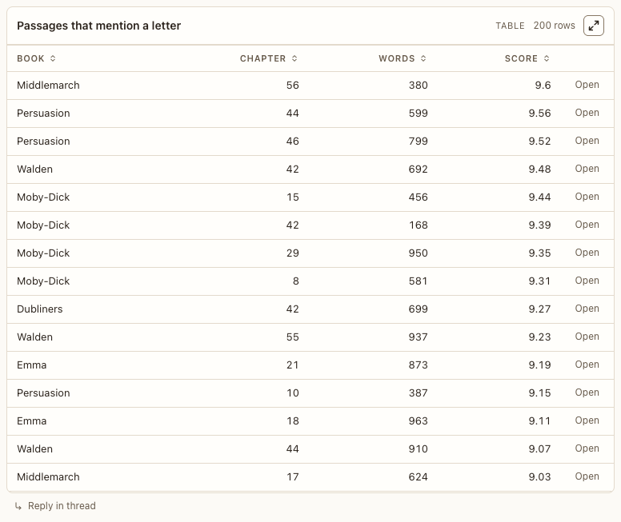

# Table block

**Where:** Agent replies with tabular data.

## Why it exists

Data you can sort and act on per row.

## Expected functionality

- A number column groups digits (12,345), but a column named for a year or an id shows its whole numbers as written: 2023, not “2,023” (#836). The name ending the label is a name (“Year”, “Fiscal-year”, “Paper IDs”, “Years (FY)”), and so is the singular starting it when no amount follows (“Year founded”, “ID number”); a label that names none of these goes by the column’s id. An amount over a year or an id, such as “Revenue per year”, “Revenue/year”, “Sales by year”, “Year-end revenue”, “ID count”, “IDs found” or “Count of IDs”, keeps its separators (#844).
- Sortable columns (number columns sort numerically), a row action button per row. The row action is an inline action, its label underlined, so it reads as a button and not as one more cell (#182).
- Large tables scroll inside the block.

## Steps to reproduce

1. Run the demo (`node tools/demo.mjs --port 4180`) and open <http://127.0.0.1:4180/> while it plays; keep the tab open.
2. In “Catalog tour”, sort by a number column and use a row action.

**Pass if:** Sorting is correct and the row action sends { rowId }.
