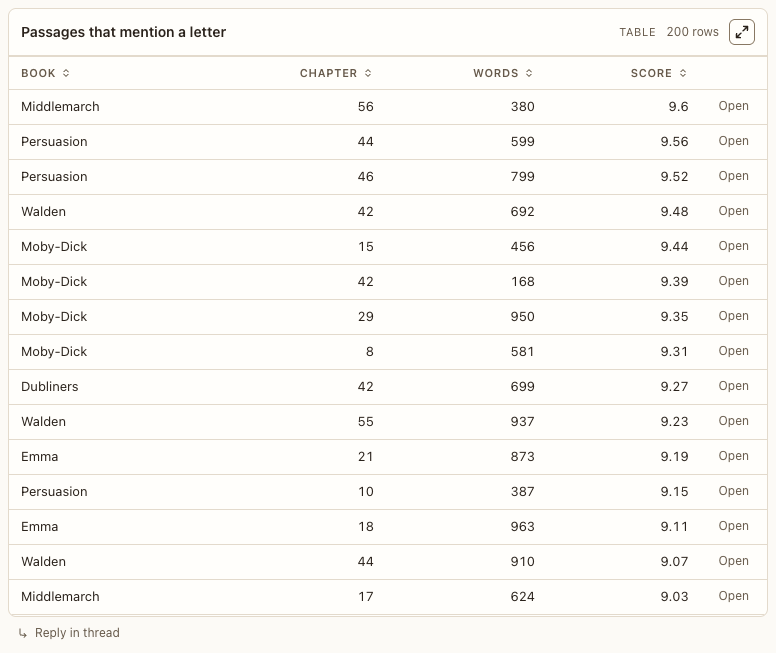

# Table block

**Where:** Agent replies with tabular data.

## Why it exists

Data you can sort and act on per row.

## Expected functionality

- Sortable columns (number columns sort numerically), a row action button per row. The row action is an inline action, its label underlined, so it reads as a button and not as one more cell (#182).
- Large tables scroll inside the block.

## Steps to reproduce

1. Run the demo (`node tools/demo.mjs --port 4180`) and open <http://127.0.0.1:4180/> while it plays; keep the tab open.
2. In “Catalog tour”, sort by a number column and use a row action.

**Pass if:** Sorting is correct and the row action sends { rowId }.
