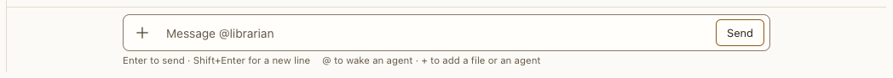

# Composer

**Where:** Bottom of a conversation.

## Why it exists

Where you write to agents; it must say who will answer.

## Expected functionality

- Enter sends, Shift+Enter adds a line; drafts are kept per conversation.
- The hint says who replies (the last speaker in a room, and in a topic or side thread the agent that spoke there last, else the one it started with: “Replying to @x”); Stop replaces Send while an agent works.
- A draft that @-mentions agents wakes those, and only those: the hint says “Wakes @critic, not @researcher (last speaker)” in place of “Replying to”, since the agent it would otherwise go to isn’t woken. It reads the message at its next turn, as every agent in the conversation does; @-mention it too to wake it (#107).
- A draft that opens with an agent’s name and “:” or “,” (“critic: …”, “Researcher, …”) mentions no one, so it would go to the agent that replies, not the one it names: the hint asks “Did you mean @critic?”, and its click adds the @. Nothing shows for a name later in the draft (“What did the researcher find?”), or for the agent that replies anyway. The end-to-end tester reads a message by the same rule (#134).
- / opens the [command menu](command-menu.md), as does the Commands button beside +; a line that starts with ! runs a [command](../transcript/command-item.md) in the conversation’s folder. The hint line says what Enter will do with either. In a topic or side thread’s composer, / and ! don’t run anything: a line that starts with ! says so in the hint before you send it, and goes to the agent as a message ([#104](https://github.com/HJeon139/postbox/issues/104)).
- Messages sent while an agent is busy are queued with Send now, Edit and remove ([screenshot](../../screenshots/queued-message.png)).
- Messages typed offline are sent when the connection returns.
- Files attach from + (Upload from computer), by pasting, or by dropping them. A file dropped anywhere in the conversation attaches to its composer; a file dropped on an open topic or side thread panel attaches to the panel’s composer, and only there.
- A sent image the server shows inline (PNG, JPEG, GIF or WebP) appears as a thumbnail with its name and size ([screenshot](../../screenshots/image-attachment.png)). The thumbnail is a link: click it, or Tab to it and press Enter, and the full image opens in a new tab. Every other file, an SVG included, is a file chip that downloads.

## Steps to reproduce

1. Run the demo (`node tools/demo.mjs --port 4180`) and open <http://127.0.0.1:4180/> while it plays; keep the tab open.
2. In “Corpus planning”, send while @indexer works; use Send now on the queued message.

**Pass if:** The queued message is delivered when @indexer finishes, or at once with Send now.
3. In “Corpus explorer”, drag a PNG screenshot and an SVG from your desktop onto the transcript, and send.

**Pass if:** Both attach to the composer before you send. The PNG shows as a thumbnail with its name and size, and the image doesn’t jump while it loads; Tab to it and press Enter, and the full image opens in a new tab. The SVG shows as a file chip.
4. Choose Reply in thread under a message, so the topic thread panel opens. Drag a file onto the panel’s replies, then another onto the conversation beside it. Open the panel’s + menu.

**Pass if:** The first file attaches only to the panel’s composer, and the second only to the conversation’s. The panel’s + menu says “Or drop files on this thread”.
5. In the panel’s composer, type `!gh --help`.

**Pass if:** Before you send, the hint says “! runs commands only in the conversation’s own composer. Here, this goes to the agent as a message.”
6. In a room where @researcher spoke last, type `critic: what’s your biggest concern?`, then `@critic what do you think?`, then open a topic thread and a side thread.

**Pass if:** The hint asks “Did you mean @critic?”, and its click makes the draft “@critic: what’s your biggest concern?”. With the @, it says “Wakes @critic, not @researcher (last speaker)”. Each thread’s composer says “Replying to @x”.

The headless check `node tools/checks/attachments.mjs` covers steps 3 and 4 with a drawn PNG and SVG, `node tools/check-commands.mjs` covers step 5, and `node tools/checks/composer-address.mjs` covers step 6.

## Related

- [plus menu](plus-menu.md)
- [mention menu](mention-menu.md)
- [command menu](command-menu.md)
