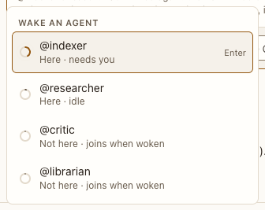

# Mention menu

**Where:** Typing @ in the composer.

## Why it exists

Waking an agent should be as easy as naming it.

## Expected functionality

- Lists agents, marking which are here and their state; arrows and Enter pick; Escape closes.

## Steps to reproduce

1. Run the demo (`node tools/demo.mjs --port 4180`) and open <http://127.0.0.1:4180/> while it plays; keep the tab open.
2. Type “@” in “Corpus planning”, pick @researcher with the keyboard.

**Pass if:** The handle is inserted, and sending wakes that agent.
