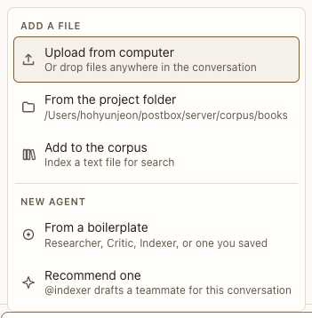

# Add menu (+)

**Where:** The + in the composer.

## Why it exists

Files and agents are added from the conversation, never from a terminal.

## Expected functionality

- Upload from computer (or drop files), From the project folder, Add to the corpus.
- New agent from a boilerplate, Recommend one, Attach a Claude Code session (when Claude Code is available).

## Steps to reproduce

1. Run the demo (`node tools/demo.mjs --port 4180`) and open <http://127.0.0.1:4180/> while it plays; keep the tab open.
2. Open +, attach a file from the project folder, and send.

**Pass if:** The attachment chip appears and is sent with the message.

## Related

- [folder picker](../../sheets/folder-picker.md)
