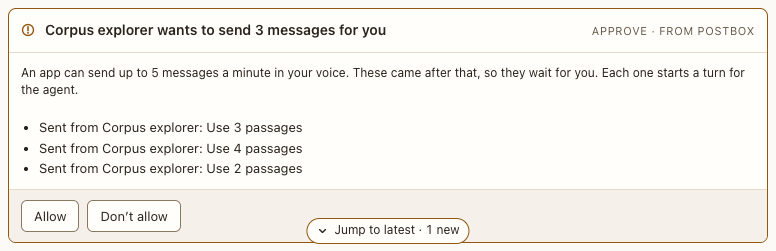

# App send card

**Where:** In the conversation, when an agent-written app sends more than 5 messages a minute.

## Why it exists

Each message an app sends shows in your voice (“Sent from Spam: …”) and starts an agent turn. An app could send them with no click at all, or by the dozen ([#38](https://github.com/HJeon139/postbox/issues/38)). Postbox now takes an app’s send only right after you click or press a key in that app, up to 5 a minute. Anything past that waits on this card for you to decide.

## Expected functionality

- Says “<app> wants to send N messages for you”, and lists each line as it would appear in your voice.
- **Allow** sends them, in order: each becomes a line in your voice and reaches the agent, as if it had gone straight through.
- **Don’t allow** drops them, and adds “Didn’t allow <app> to send N messages”. The agent isn’t woken.
- More sends from the same app while the card is open join it, in order. One card holds up to 20; past that, the app’s send is refused with a reason.
- The app is told its send is waiting (`postbox.send` resolves with `held: true`), so nothing is dropped silently.
- The card survives a reload and a server restart, and can still be answered.
- The agent needs you while the card is open, as with a permission card: the overview card has Allow and Don’t allow too, and a notice says so once per card.
- Amber border while open; both buttons work by keyboard. The first press turns both off, so a double click answers once. Focus then moves to the composer of the thread the card is in (the panel’s, in a thread panel).
- In a browser without per-frame activation (`MessageEvent.userActivation`, which Chrome has), every send waits on this card.
- Sends allowed on a card don’t count against the next minute.

## Steps to reproduce

1. Run `node tools/checks/app-send.mjs`. It clicks an app’s button 6 times with real input, checks the card, and presses Allow. Every line should say PASS.
2. By hand: run the demo (`node tools/demo.mjs --port 4180`), open <http://127.0.0.1:4180/>, and let “Corpus explorer” show its app.
3. Send 6 events the way a script would: `for i in 1 2 3 4 5 6; do curl -s -X POST http://127.0.0.1:4180/api/apps/corpus-explorer/event -H 'content-type: application/json' -d "{\"action\":\"ping\",\"values\":{\"summary\":\"Ping $i\"}}"; echo; done`.
4. Answer the card with the keyboard (Tab to Allow, then Enter). Repeat step 3, reload the page, restart the server, and answer Don’t allow.

**Pass if:**
- The overview shows the agent as needing you, with the card’s buttons, until you answer.
- The first 5 show as lines in your voice and the sixth waits on the card, by keyboard or mouse.
- Allow sends the waiting lines; Don’t allow sends none.
- An open card is still there, and still works, after a reload and a restart.

## Related

- [Agent-written app](../agent-apps/app-frame.md)
- [Permission card](permission-card.md)
- [Refusal card](refusal-card.md)
