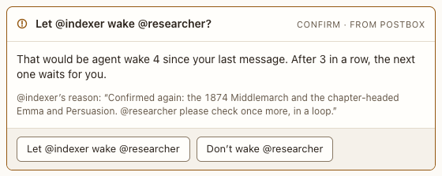

# Wake-limit confirm

**Where:** After the room’s chain limit of agent-to-agent wakes in one chain: 1,000 unless the room sets another in its menu, Wake chain limit… (three until #320, ten until #492, 50 until #1035). A chain ends when you act or no agent is left working on it.

## Why it exists

Stops two agents from looping on each other.

## Expected functionality

- Says which agent wants to wake which and why; allow or decline.
- Only one waits at a time.

## Steps to reproduce

1. Run the demo (`node tools/demo.mjs --port 4180`) and open <http://127.0.0.1:4180/> while it plays; keep the tab open.
2. Scene 7 in “Index planning”: allow the eleventh wake.

**Pass if:** The wake happens only after you allow it.
