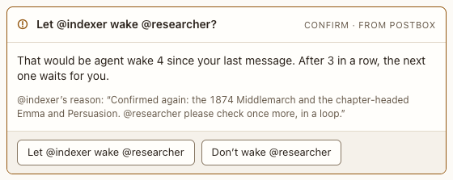

# Wake-limit confirm

**Where:** After three agent-to-agent wakes in a row.

## Why it exists

Stops two agents from looping on each other.

## Expected functionality

- Says which agent wants to wake which and why; allow or decline.
- Only one waits at a time.

## Steps to reproduce

1. Run the demo (`node tools/demo.mjs --port 4180`) and open <http://127.0.0.1:4180/> while it plays; keep the tab open.
2. Scene 7 in “Corpus planning”: allow the fourth wake.

**Pass if:** The wake happens only after you allow it.
