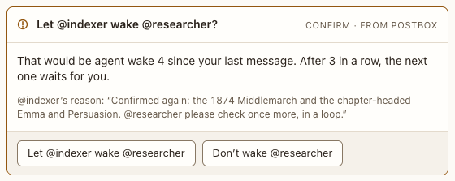

# Add-agent confirm, and the chain’s one line

**Where:** In a conversation, when an agent @-mentions or wakes an agent the conversation doesn’t have (#228). Until it’s retaken, the screenshot shows the wake-limit card this replaced (#1623).

## Why it exists

An agent can’t bring another into your conversation by itself: only you decide who is in it, so the card asks you. Agents waking each other is never asked about. At the cap of agent wakes in a row without you, a loop guard, the chain stops with one line in the room and no card, and your next message starts it again (#1623).

## Expected functionality

- The card says which agent wants to add which, and its reason; Add or Don’t add.
- Only one waits at a time. Another wake that needs a card while it waits is held on it, and the card says whose (#439): Add sends them too, and Don’t add tells each agent its message didn’t go.
- At the cap, 1,000 wakes in a row unless `POSTBOX_CHAIN_LIMIT` sets another number, the next wake doesn’t go. The room says “Agents stopped waking each other after 1,000 wakes in a row. Your next message lets them start again.” once, with no card, no button and nothing that needs you.
- A wake-limit card from before #1623 shows as a line, such as “waker asked to wake woken · allowed”, with no buttons.

## Steps to reproduce

1. Start a Postbox of your own with a low cap and the mock agents: `POSTBOX_CHAIN_LIMIT=3 POSTBOX_BACKENDS=mock node server/index.mjs --port 4190 --data <a temp folder> --fresh`, and open <http://127.0.0.1:4190/>.
2. Make a room with @indexer and @researcher, and send “@indexer ping researcher in a loop”.
3. In a Postbox started without those two variables, in a room with one Claude Code agent, ask it to send a one-line question, by an @-mention, to another agent you have that isn’t in the room, and choose Add on the card.

**Pass if:** In step 2 the agents stop after three wakes, and the room shows the one line once, with no card, and the room’s row shows nothing that needs you. In step 3 the card names both agents and the reason, and Add adds the other agent with a “joined” line, and it gets the question.

## How to check

`npx playwright test tests/browser/chain-stop.spec.mjs tests/browser/chain-stop-loop.spec.mjs` and `node --test tests/process/chain-limit.test.mjs`.
