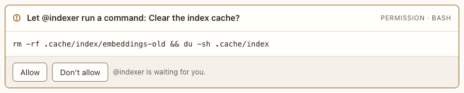

# Permission card

**Where:** In the conversation, when an agent, or one of its subagents, asks before a risky tool call.

## Why it exists

In ask mode (and when auto mode can’t decide) you approve exactly what will run. “Yes, but change this” is the most common real answer, and a safe command shouldn’t ask again every time ([#10](https://github.com/HJeon139/postbox/issues/10), [#66](https://github.com/HJeon139/postbox/issues/66)). Answering here never sends you to a terminal.

## Expected functionality

- Shows the exact command or file, wrapped so it’s fully visible. A subagent’s prompt names it: “Let @coder’s subagent (Explore) …”.
- A call that writes outside Postbox (an MCP tool that creates, changes or deletes, or `gh issue create` and the like) asks in every mode but Run everything, and says where it lands, then that nothing happens yet: “This writes outside Postbox, to docs (folder “Use cases”). Nothing is created, sent or changed until you allow it.” The target is the folder, database, parent, repository, channel, space, project or path its input names, when it names one. Its draft (the longest of its markdown, content, body, text, message or description) shows as it will read, above the other arguments, in a box that scrolls; the arguments show “(the draft above)” in its place ([screenshot](../../screenshots/write-card.png), [#112](https://github.com/HJeon139/postbox/issues/112)). Always allow there saves a rule for that tool, after which its writes run without a card, and the card says so first: “From now on @coder can use mcp__docs__create_document without showing you a draft.”; a persona that can publish outside Postbox runs its publishing tools without one. For an agent in Auto, a call you asked for in this turn’s message, or in the block you approved, runs without a card and leaves a line instead ([Requested call line](requested-call-line.md), [#296](https://github.com/HJeon139/postbox/issues/296)).
- An MCP tool call names the tool, in its own case (`mcp__github__create_issue`, not uppercased with the card’s label), and shows its arguments. A Codex agent’s card reads “Let @critic use github tool create_issue?”, with the tool’s description and arguments, never “run a command” ([#150](https://github.com/HJeon139/postbox/issues/150)).
- **Allow:** runs the call as asked.
- **Always allow:** runs it, and keeps allowing calls like it. The card says the rule and where it’s saved before you click: “Always allow `Bash(npm test:*)` in this folder (.claude/settings.local.json)”. It isn’t offered when there’s nothing safe to save: the Agent SDK suggests nothing, or says the rule would grant more than this call, or the rule would be too long to keep, or the CLI asked about a chained command (`cd src && npm test`): Claude Code checks each part on its own, so a rule for the whole line would never match ([#238](https://github.com/HJeon139/postbox/issues/238)), or about one with a `*`, which a rule would read as a wildcard ([#281](https://github.com/HJeon139/postbox/issues/281)). For a program that runs the command after it (`env`, `bash -c`, `sudo`), the rule is the exact command, never `Bash(env:*)`. If the card expires while the rule is being saved, the rule is taken out again and nothing stays saved.
  - With the Agent SDK, the rule is Claude Code’s own suggestion. One it suggested for the session only is saved in the folder’s local settings instead (each Postbox turn is a new session), and the card says so.
  - Claude Code’s CLI suggests nothing to its prompt tool, so Postbox makes the rule, as the refusal card does, and saves it there itself.
- **Edit…:** opens the command (or, for other tools, the input as JSON) to change, then **Allow with this edit** runs what you wrote, with the call’s other settings (its description, timeout, background flag) kept. It isn’t offered for an input too large to show in full. JSON that doesn’t parse says so, and nothing is sent. Escape cancels; Cmd+Enter or Ctrl+Enter allows.
- **Don’t allow…:** asks why, optionally; Enter refuses. The agent reads your reason.
- Once answered, the card says how (“Always allowed (Bash(npm test:*))”, “Allowed with your edit”, with what ran, or “Not allowed”, with your reason), and a line in your voice says the same.
- The agent needs you until you answer; Stop answers no and marks the card expired. A card nobody answers for 25 hours (a minute short of the time Claude Code waits for the call, so the no still reaches it) expires too, and says “Expired: nobody answered within 25 hours” ([#220](https://github.com/HJeon139/postbox/issues/220)).
- Only a Claude Code agent asks this way. An Agent SDK, Kiro, Codex or Antigravity agent isn’t offered Postbox’s permission_prompt tool, and one that calls it anyway is told at once that it isn’t for it, with no card.
- Every control works by keyboard; after an answer, focus goes back to the composer.

## Steps to reproduce

1. Run `npx playwright test permissions` (`tests/browser/permissions.spec.mjs`). It answers a card each way with real clicks and key presses, including a subagent’s prompt, a Codex MCP tool call, and a write outside Postbox with its draft. Every test should pass. `npx playwright test permission-cards` checks how an expired card reads.
2. Run the demo (`node tools/demo.mjs --port 4180`) and open <http://127.0.0.1:4180/> while it plays; keep the tab open. Scene 10 (“Clear the index cache”): answer Allow.
3. Run Postbox with real agents (`node server/index.mjs --port 4181 --data /tmp/pb-uat-real --fresh`, with Claude Code installed and signed in) and open <http://127.0.0.1:4181/>. In a project whose folder you can lose, set an agent to Ask me and send: “Run `echo hi > note.txt` yourself, then have a general-purpose subagent run `echo bye > note2.txt`.”
4. On the first card, choose Edit…, change the command to `echo edited > note.txt`, and allow it. On the subagent’s card, choose Always allow.
5. Ask again for `echo again > note2.txt`, and choose Don’t allow… with a reason.

**Pass if:**
- `note.txt` holds “edited”, and the card shows what ran.
- The subagent’s card names it, and its Always allow line showed the rule before you clicked. The rule is in the folder’s `.claude/settings.local.json`, and `claude` in a terminal there lists it under `/permissions`.
- The agent’s reply mentions your reason.

## Related

- [Permissions panel](../../shell/permissions-panel.md)
- [Refusal card](refusal-card.md)
- [Requested call line](requested-call-line.md)
