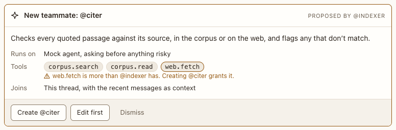

# New teammate proposal

**Where:** When an agent proposes a new agent.

## Why it exists

Agents may suggest teammates, but only you create them; extra tools are highlighted.

## Expected functionality

- Shows the proposed handle, description, backend, and tools, marking tools the proposer doesn’t have.
- Create makes the persona and joins it; Dismiss declines.

## Steps to reproduce

1. Run the demo (`node tools/demo.mjs --port 4180`) and open <http://127.0.0.1:4180/> while it plays; keep the tab open.
2. Scene 9 in “Check my quotes”: create the teammate.

**Pass if:** The new agent joins the conversation.
