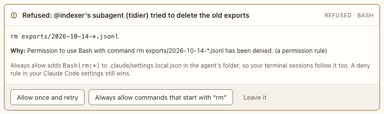

# Refusal card

**Where:** In the conversation, when Claude Code refuses an agent’s or a subagent’s tool call without asking you.

## Why it exists

Auto mode’s safety check, a deny rule, or the permission mode can turn a call down without a permission card. Without this card the agent just stops, and fixing it means leaving Postbox for a terminal ([#65](https://github.com/HJeon139/postbox/issues/65)).

## Expected functionality

- Names who was refused (the agent, or its subagent by name), the exact command or input, and why.
- **Allow once and retry:** the next turn runs with that exact call allowed, and the agent is told to try it again exactly as before. A rule that matches a call settles it before auto mode’s safety check sees it, so this works for most of the check’s refusals too (architecture.md, “Permissions”, lists the exceptions).
- **A chained command** (parts joined by `&&`, `||`, `;`, `|` or `&`, a process substitution `<( )`, or `$(( ))`) has neither Allow once nor Always allow. Claude Code checks each part against its rules on its own, so a rule for the whole line never matches it and the retry was refused again ([#238](https://github.com/HJeon139/postbox/issues/238)). The card says so, and suggests asking the agent to run the parts as separate commands, each of which gets a card of its own if it’s refused again. The card offers only Leave it.
- **A command substitution** (`$( )` or backquotes), a separator inside `${ }`, and `[[ … && … ]]` don’t chain it: real Claude Code turns ran each on the exact command’s rule ([#309](https://github.com/HJeon139/postbox/issues/309)), so the card offers Allow once, as for Claude Code’s own `git commit -m "$(cat <<'EOF' …)"`.
- **A command with a `*`** has neither Allow once nor Always allow: Claude Code reads `*` in a rule as a wildcard, so a rule with the command’s own text would allow other commands too ([#281](https://github.com/HJeon139/postbox/issues/281)). The card says so, and suggests asking the agent to name the files.
- **A program that runs the command or code after it** (`bash -c`, `sh`, `env`, `sudo`, `xargs`, `nohup`, `time`, `nice`, `perl`, `ruby`, `awk`, `ssh` and the like), or one whose second word is a flag (`node -e`, `python3 -c`, `git -c`), gets only its exact text for Always allow, never `Bash(env:*)` or `Bash(node -e:*)`, which would allow any command or code ([#281](https://github.com/HJeon139/postbox/issues/281)).
- **Always allow …:** adds the rule shown on the card to `.claude/settings.local.json` in the agent’s folder, which your terminal sessions read too, then the agent tries again.
- **Leave it:** keeps the refusal; the agent isn’t woken.
- The agent needs you until you answer; its ring in the sidebar goes to the card (#285).
- A call you declined on a permission card never gets a refusal card too.
- The refused step shows in the activity list as refused, pointing to the card.

## Steps to reproduce

1. Run the demo (`node tools/demo.mjs --port 4180`) and open <http://127.0.0.1:4180/> while it plays; keep the tab open.
2. Scene 10b (“Tidy the workspace”): the subagent’s `rm` is refused. Check the card, then answer Allow once and retry.
3. Run `npx playwright test permission-cards` (`tests/browser/permission-cards.spec.mjs`). It checks the buttons and words on a refused chained command, a single one, one with a `*` and one with `env`. Every test should pass.
4. Run Postbox with real agents (`node server/index.mjs --port 4181 --data /tmp/pb-uat-real --fresh`), with Claude Code installed and signed in, and open <http://127.0.0.1:4181/>. In the agent’s folder, add `"permissions": { "deny": ["Bash(rm:*)"] }` to `.claude/settings.local.json`. Ask the agent to delete a scratch file itself, then to have a subagent do it.
5. In step 4, answer Always allow on one card. Check `.claude/settings.local.json`, and run `/permissions` in a terminal in the same folder.

**Pass if:**
- Every refusal has a card naming the right agent or subagent.
- Allow once makes the agent retry and succeed once.
- In auto mode, a single command auto mode’s check refused runs after Allow once; a refused `cd <folder> && <command>` has no Allow once, and says why.
- Always allow writes the rule, and the CLI lists it.
- A deny rule still wins over it, and the card says so.

## Related

- [Permission card](permission-card.md)
- [Activity line](../transcript/activity-line.md)
- [Working row](../transcript/working-row.md)
