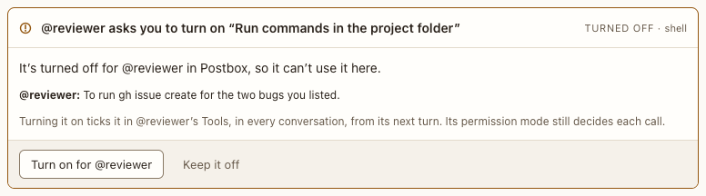

# Tool request card

**Where:** In the conversation, when an agent needs a tool that’s turned off for it in Postbox, and asks for it with `ask_for_tool`.

## Why it exists

An unticked tool in a persona’s Tools is removed from the agent’s tool list, so the agent can’t tell it apart from a computer that lacks it. A critic without shell told the person it had “no shell, gh or GitHub access”, while `gh` worked fine in their terminal, and the person had to guess at the setting ([#104](https://github.com/HJeon139/postbox/issues/104)). The agent guide now names what’s off for the agent, and this card lets the person turn it on from the reply instead of hunting for the setting.

## Expected functionality

- The title names the setting as the persona editor does: “@critic asks you to turn on “Run commands in the project folder””. The label beside it names the tool by its id (shell), in its own case.
- The body says it’s turned off for that agent in Postbox, and quotes the agent’s reason.
- Before you answer, it says what turning it on does: it ticks the tool in that persona’s Tools, in every conversation, from its next turn, and the permission mode still decides each call.
- **Turn on for @critic:** ticks the tool, says “Turned on.”, adds a line in your voice, and the agent’s next turn starts with the tool in its list.
- **The same tool turned on anywhere else** (the agent’s quick panel in the sidebar, or the persona editor) answers the card the same way, in every conversation it’s open in: it says “Turned on.”, the agent stops needing you, and it carries on with the tool ([#237](https://github.com/HJeon139/postbox/issues/237)). Once it’s on, the label beside the title says “Turned on · shell”.
- **Keep it off:** leaves the persona as it was, says “Kept off.”, and the agent is told to go on without it.
- The agent needs you until you answer. Every control works by keyboard; after an answer, focus goes back to the composer.

## Steps to reproduce

1. Run `npx playwright test permissions` (`tests/browser/permissions.spec.mjs`). It answers a scripted agent’s request with a real click. Every test should pass.
2. Run `node tools/checks/permission-cards.mjs`. It turns Shell on from the agent’s quick panel while a card asks for it. Every line should say ok.
3. Run Postbox with real agents (`node server/index.mjs --port 4181 --data /tmp/pb-uat-real --fresh`, with Claude Code installed and signed in) and open <http://127.0.0.1:4181/>. Give a persona every tool but “Run commands in the project folder”, then ask it: “Run `gh --version` and tell me what it prints.”

**Pass if:**
- The agent says shell is turned off for it in Postbox, not that the computer has no shell, and shows this card.
- Turn on for @… runs the command on the agent’s next turn.
- Turning the tool on from the agent’s quick panel instead answers the card, and the agent runs the command without another click.

## Related

- [Permission card](permission-card.md)
- [Refusal card](refusal-card.md)
