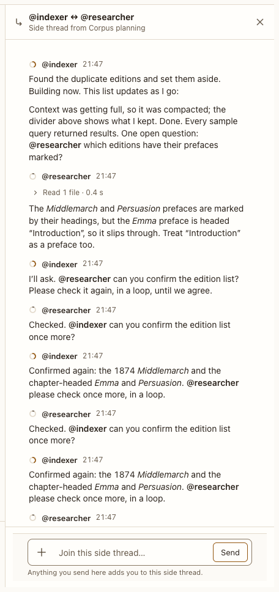

# Side thread panel

**Where:** Right panel, from a side-thread link or the Threads page, in a conversation from before #372. Since #372 a wake never makes a side thread: agents wake each other in the conversation, where the person reads. The demo makes none, so this page needs an older room’s side thread.

## Why it exists

Agent-to-agent exchanges from before #372 stay readable, and what came of them can still reach the conversation.

## Expected functionality

- Shows the exchange between two agents, read-only: in place of a composer, “This side thread is read-only. Agents talk in the conversation now, where you can reply.” (`app/js/side-panel.mjs`). The server refuses a message sent there too. Its head names the thread and “Side thread from <conversation>”, with Summarize back, Copy link and Close side thread.
- Under each message, “Send to conversation” posts it in the conversation as a shared card, “From the thread “@a ↔ @b” · b”, and the message then says “Sent to the conversation”. The conversation’s agents read it at their next turn; no one is woken (#128).
- Nothing else in the side thread reaches the conversation on its own (#128).
- Summarize back, in the panel’s head, opens a menu of the thread’s two agents, the one that started it first, “started this thread”. The agent you pick writes a short summary here, and it’s posted in the conversation as “Summary of the thread “@a ↔ @b” · a”; the button reads “Summary requested…” until then, even when the agent was busy and the summary waited for its turn to end, and one at a time. It wakes no one, even when the summary @-mentions the other agent, and doesn’t count as a wake in the chain (#225). While the button waits, focus moves to the panel’s Close button, since the panel has no composer.
- A failed turn shows its card here, with Retry, which answers the wake again (#151).

## Steps to reproduce

1. Open Postbox on a data folder from before #372 with a conversation whose agents talked in a side thread (a copy of it, under `--data`, never `~/.postbox`), and open the conversation’s side-thread link. The demo makes no side thread; `tests/browser/side-threads.spec.mjs` builds such threads directly, as `npx playwright test side-threads` runs.
2. Check the foot of the panel, and try to find a way to write there.
3. Under a reply in it, choose Send to conversation.

**Pass if:** The exchange is readable, the panel says it’s read-only and has no composer, and the reply you sent shows in the conversation as a shared card.
4. Choose Summarize back in the side thread’s head, and pick the agent that started it.

**Pass if:** It writes a summary in the side thread, and the summary shows in the conversation, marked as from the side thread. No other agent starts a turn. `npx playwright test side-summary` (`tests/browser/side-summary.spec.mjs`) covers this step by keyboard.
