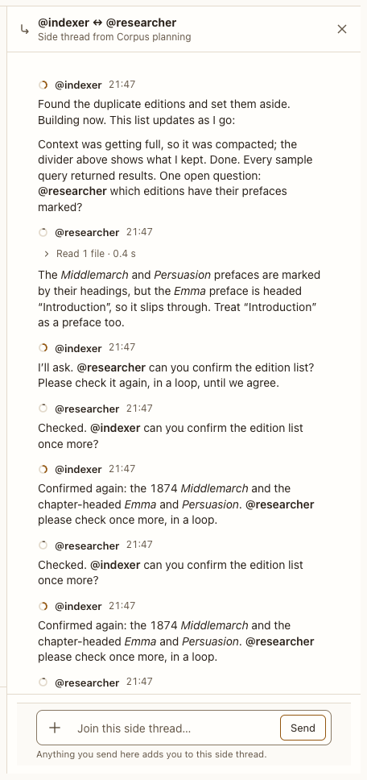

# Side thread panel

**Where:** Right panel, from a side-thread link.

## Why it exists

Agent-to-agent exchanges stay out of your conversation but remain visible and joinable.

## Expected functionality

- Shows the exchange between two agents; typing there adds you to it.
- Its agents are the conversation’s own, one session each (#228). A wake for a busy one waits in this thread’s queue, never a fork: “@a’s message · waits for @b to finish”, with Send now and Remove, and no Edit. Stopping @b drops it, and @a is told at its next turn; Send now to @b keeps it. An agent that wakes a persona the conversation doesn’t have brings a card, “Add @x to this conversation?”: Add joins it and delivers the wake; Don’t add tells the agent.
- Under each message, “Send to conversation” posts it in the conversation as a shared card, “From the thread “@a ↔ @b” · @b”, and the message then says “Sent to the conversation”. The conversation’s agents read it at their next turn; no one is woken (#128).
- Ask an agent there to “post this in the main chat”, and it can: its bring_to_conversation tool posts a shared card in the conversation, marked “shared by @b in a turn you started”. Only a turn you started, with a message in a side or topic thread, can use it. Nothing else in the side thread reaches the conversation on its own (#128).
- A failed turn shows its card here, with Retry, which answers the wake again (#151).
- A file dropped on the panel attaches to the panel’s composer, not the conversation’s ([composer](../composer/composer.md), step 4).

## Steps to reproduce

1. Run the demo (`node tools/demo.mjs --port 4180`) and open <http://127.0.0.1:4180/> while it plays; keep the tab open.
2. In “Corpus planning”, open the side-thread link.

3. Hover a reply in it and choose Send to conversation; then ask one of its agents to post a summary in the main chat.

**Pass if:** The exchange is readable and you can reply in it, the reply you sent shows in the conversation as yours to send, and the agent’s post shows there marked as shared by it.
