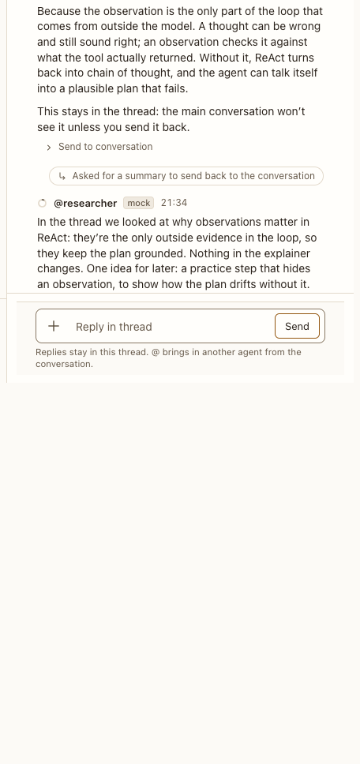

# Topic thread panel

**Where:** Right panel, from Reply in thread.

## Why it exists

Follow a side question without filling the conversation: the thread’s replies stay in the thread. Its agents are the conversation’s own, answering from their one session there, so they remember the thread (#228). To keep a side question out of an agent’s memory, start a new conversation.

## Expected functionality

- Shows the root message (clamped, Show all), the replies, and a composer.
- Under its header, one line names who is in the thread (“@indexer and @researcher are in this thread.”): the agent it started with and those that answered there. It has no list of agents of its own (#228); their rows, and their [quick panel](../../shell/rail/agents-section.md), are in the sidebar.
- An agent you @-mention there answers from its one session in the conversation, never a fork. A persona the conversation doesn’t have joins it, with “Joined when you @-mentioned it in a thread” under its row. Your message for an agent busy elsewhere waits in the thread’s queue.
- The conversation’s other agents see that the thread has something new, as one line in their catch-up with a summary of a few words, written after its last reply by a separate Haiku call (no summary without a Claude backend). They read the thread only if they choose.
- Summarize back posts a summary to the conversation; Send to conversation posts one reply.
- One summary at a time (#93): from the click until the summary is posted, the button reads “Summary requested…” and is disabled, in every tab, and the server refuses a second request. If the turn fails or is stopped, the button comes back.
- Once the summary is posted, the reply it came from shows “Sent to the conversation”, with no Send button, so it can’t go twice. While the summary is still being written, its replies can’t be sent on their own.
- An agent’s first turn in the thread starts with the message the thread is about: its text, or a block’s or app’s title and text version, and isn’t told again (#81). Each turn there also catches up on what others said in the thread since it last took part.
- Close returns to the conversation; on a phone it’s full screen. Its width and how it shares the window with the conversation (a handle on its left edge, the sidebar hiding while it’s open, full screen where there’s no room beside) are the right pane’s: see [Work view](../work-view.md), “The pane” and “Room for the conversation”.
- A file dropped on the panel attaches to the panel’s composer, not the conversation’s ([composer](../composer/composer.md), step 4).

## Steps to reproduce

1. Run the demo (`node tools/demo.mjs --port 4180`) and open <http://127.0.0.1:4180/> while it plays; keep the tab open.
2. Reply in thread under an agent reply, ask a question, Summarize back.
3. Run `node tools/check-transcript.mjs`: it double-clicks Summarize back, asks again from a second “tab”, and checks one summary and the reply marked sent.
4. Run Postbox with real agents (`node server/index.mjs --port 4181 --data /tmp/pb-uat-real --fresh`, with Claude Code installed and signed in) and open <http://127.0.0.1:4181/>. Open a thread on an earlier message and ask about something said after it; the agent knows it, since it’s the same session. Then open a thread on a table and @-mention an agent that isn’t in the conversation, asking it to check one row.

**Pass if:** The summary appears in the conversation once, the reply shows it was sent, no session is made in the thread, and the agent brought in can quote the row without you pasting it.

## Related

- [message actions](../transcript/message-actions.md)
