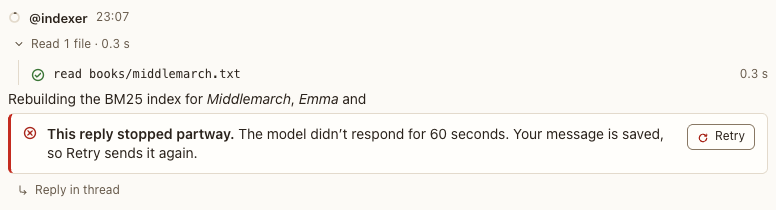
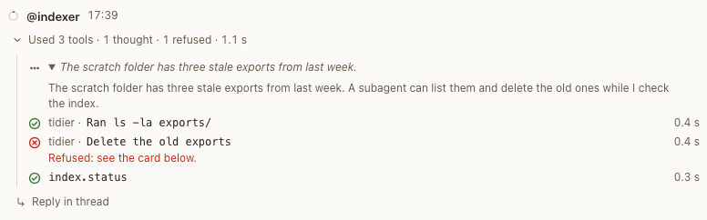

# Activity line

**Where:** Above an agent reply that used tools or thought before answering.

## Why it exists

Shows every step of the work without flooding the transcript, including what subagents did and what was refused.

## Expected functionality

- **Collapsed:** “Used N tools”, with a count of thoughts and refused steps when there are any, and the time its tool steps took, said as such (“3.6 s in tools”). The turn’s elapsed time is on the line of its list, under its last reply (“23 s in all”, #214).
- **Expanded:** each step with its state (running, done, failed, refused) and duration.
- **Subagent steps:** listed under the subagent’s name (“tidier · Ran ls -la exports/”), and nested under the step that started the subagent, at any depth (#73). A subagent’s step says what it returned once it has, and reads running while a subagent started in the background works on. One still working when its turn is stopped reads “Stopped: its turn ended before it finished”, with its own calls.
- **Subagent narration:** what a subagent says about its work (“general-purpose: I’ll count the words…”) is a step of its own, by its first sentence, opening to the whole text. It’s attributed to the subagent, and never part of the agent’s reply.
- **Failed steps:** say why, in the first sentence of the tool’s error.
- **Refused steps:** point to their refusal card.
- **Thoughts:** listed by their first sentence, and open to the whole summary. A subagent’s thoughts are its own, under its name.
- **While the reply updates:** the activity list and any thought the person opened stay open as new steps arrive. If the person closes the activity list, later updates keep it closed. A new reply starts collapsed (#488).

## Steps to reproduce

1. Run the demo (`node tools/demo.mjs --port 4180`) and open <http://127.0.0.1:4180/> while it plays; keep the tab open.
2. Open “Index the shelf” and expand the activity line.
3. Open “Tidy the workspace” (scene 10b), expand the activity line, and open the thought.
4. With real agents, ask an agent to use a subagent for a small task, and expand its activity line afterwards.

**Pass if:**
- Steps, states and durations are listed.
- Subagent steps carry the subagent’s name, and nest under the subagent’s step with its narration and thoughts.
- The refused step reads as refused.
- The thought opens to its text.

## Related

- [Working row](working-row.md)
- [Refusal card](../harness-cards/refusal-card.md)
