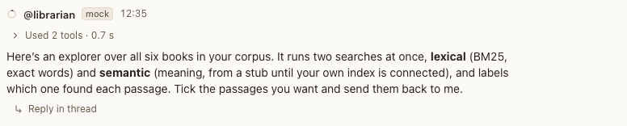

# Agent reply

**Where:** Left-aligned in the transcript.

## Why it exists

The agent’s answer, streamed as it’s written, in Markdown.

## Expected functionality

- Speaker line: ring, @name, status word while it works, time.
- Text streams with a caret; only the newest segment of a turn shows the caret.
- Raw HTML is shown as text, never rendered; links open in a new tab with noopener.
- Bold and italic text can hold inline code: **Add three checks to `rename.py`:** is bold, with no asterisks showing (#82).
- The one exception: `

Answer
 … 
`, with no attributes, folds its Markdown away until you open it (agents use it to hide an exercise’s answer). It opens by click or by Enter on the summary, and folds can nest. A `
` with attributes, or one that’s never closed, stays text.

## Steps to reproduce

1. Run the demo (`node tools/demo.mjs --port 4180`) and open <http://127.0.0.1:4180/> while it plays; keep the tab open.
2. Watch a reply stream in “Corpus explorer”.
3. Run Postbox with real agents (`node server/index.mjs --port 4181 --data /tmp/pb-uat-real --fresh`, with Claude Code installed and signed in) and open <http://127.0.0.1:4181/>. Ask an agent to reply with `<b>hi</b>` and a link, then ask @assistant to explain something step by step and end with an exercise whose answer is hidden. Ask for a numbered list of steps whose labels are bold and name a file in backticks.

**Pass if:** Text streams smoothly, HTML stays text, links open in a new tab, the exercise’s answer is folded under “Answer”, with no tags showing, and bold labels with code in them show no asterisks.

## Related

- [activity line](activity-line.md)
- [citations](citations.md)
