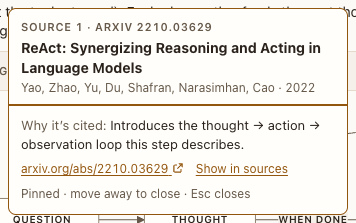

# Citations and sources

**Where:** Explainer replies with [1]-style markers.

## Why it exists

Claims an agent makes from papers must be checkable.

## Expected functionality

- Markers link to a sources list under the reply.
- Hovering or focusing a marker opens a card: a loading bar, then it stays; leaving counts down before closing; Enter or Space pins and moves focus into the card, and Escape closes it and returns focus to the marker.

## Steps to reproduce

1. Run the demo (`node tools/demo.mjs --port 4180`) and open <http://127.0.0.1:4180/> while it plays; keep the tab open.
2. In “ReAct, step by step”, hover marker 1, then Tab to it and press Enter, then Escape.

**Pass if:** The card opens by mouse and keyboard and doesn’t flicker.

## Related

- [glossary terms](glossary-terms.md)
