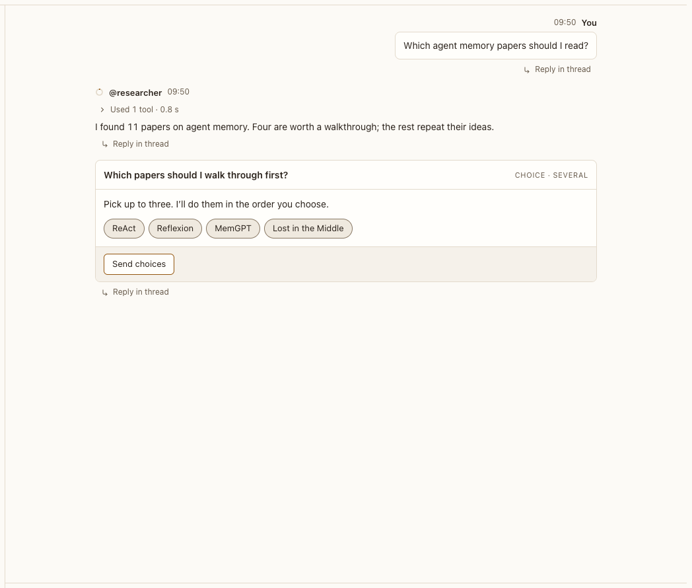

# Empty conversation

**Where:** A conversation with no messages.

## Why it exists

A blank screen gives no idea what an agent can do; examples make the first message easy.

## Expected functionality

- Shows the agent’s ring, name and description, and its example prompts as buttons.
- Choosing an example sends it.

## Steps to reproduce

1. Run the demo (`node tools/demo.mjs --port 4180`) and open <http://127.0.0.1:4180/> while it plays; keep the tab open.
2. Open “Agent memory papers” before the demo reaches it, or create a new conversation.

**Pass if:** The examples are shown and send when chosen.
