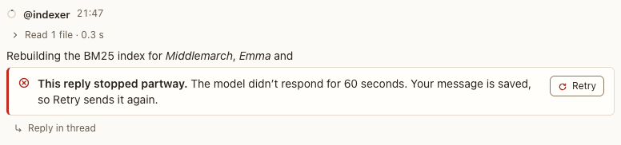

# Failed and stopped replies

**Where:** In place of a reply that didn’t finish.

## Why it exists

A failure must be visible, explained, and recoverable; a stop must look different from a failure.

## Expected functionality

- A failed reply shows the reason and Retry; the agent needs you until you retry or move on.
- A reply lost to the network goes again on its own, once (#466): it shows “Retried below” with “The network dropped during this turn, so Postbox sent it again.”, no Retry, no blocking alert, and the agent isn’t failed. Lost again, it fails as any reply does.
- A reply its backend refused for quota fails without an alert, and every agent on that backend shows “out of quota”, until the reset time when the backend gave one (#442). Nothing says needs you. One notice says the backend ran out, however many of its agents did, and says when Postbox doesn’t know the reset.
- A stopped reply says why it stopped ([screenshot](../../screenshots/stopped-reply.png)):
  - “Stopped by you at hh:mm” after Stop;
  - “Stopped by you at hh:mm · its background work kept running” after Stop with Keep running (#249);
  - “Interrupted by Send now at hh:mm” after Send now, from the composer or the queue (#215).
- A reply stopped before Postbox recorded why reads “Stopped by you at hh:mm”.

## Steps to reproduce

1. Run the demo (`node tools/demo.mjs --port 4180`) and open <http://127.0.0.1:4180/> while it plays; keep the tab open.
2. Open “Index the shelf” after scene 8 and press Retry on the failed reply.

**Pass if:** Retry runs the turn again and the failed reply is marked “Retried below”.

The lost and quota cases need a dropped network or a used-up quota, which the demo doesn’t stage; `tests/browser/lost-resend.spec.mjs` and `tests/turn-failure-classes.test.mjs` cover them.
