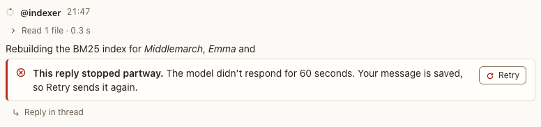

# Failed and stopped replies

**Where:** In place of a reply that didn’t finish.

## Why it exists

A failure must be visible, explained, and recoverable; a stop must look different from a failure.

## Expected functionality

- A failed reply shows the reason and Retry; the agent needs you until you retry or move on.
- A stopped reply says why it stopped ([screenshot](../../screenshots/stopped-reply.png)):
  - “Stopped by you at hh:mm” after Stop;
  - “Stopped by you at hh:mm · its background work kept running” after Stop with Keep running (#249);
  - “Interrupted by Send now at hh:mm” after Send now, from the composer or the queue (#215).
- A reply stopped before Postbox recorded why reads “Stopped by you at hh:mm”.

## Steps to reproduce

1. Run the demo (`node tools/demo.mjs --port 4180`) and open <http://127.0.0.1:4180/> while it plays; keep the tab open.
2. Open “Index the shelf” after scene 8 and press Retry on the failed reply.

**Pass if:** Retry runs the turn again and the failed reply is marked “Retried below”.
