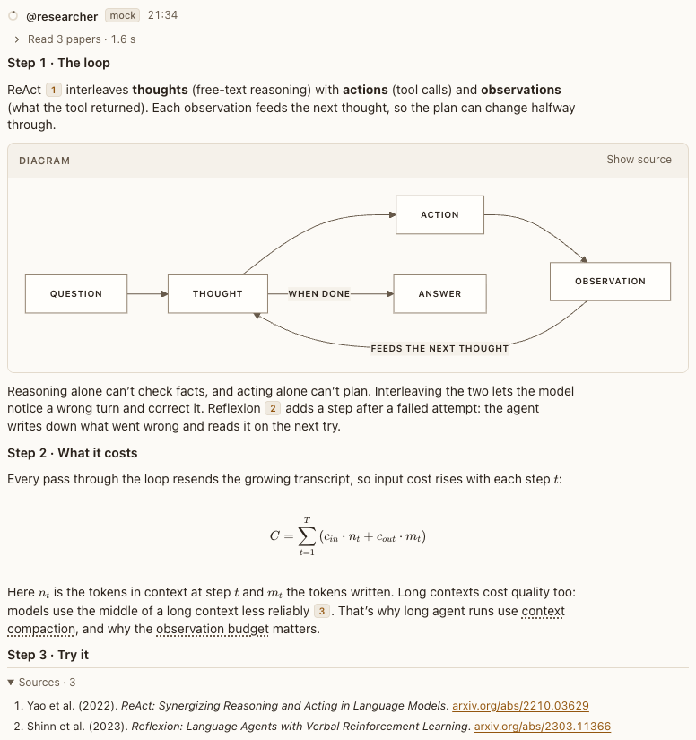

# Glossary terms

**Where:** Dotted-underlined words in replies.

## Why it exists

Terms an agent coins in a session (“observation budget”) must stay understandable later.

## Expected functionality

- Defined terms link everywhere in the conversation and show their definition in a card on hover or focus.
- Undefined coined terms are flagged to the agent, which defines them.
- Terms inside a definition link too, all but the term itself (#103). Hovering one opens its card over the first, up to three deep. Leaving the top card for the one under it closes only the top one, and a term whose card is already open (U → U:13 → U) opens nothing.
- By keyboard, Enter or Space pins a term’s card and moves focus into it, Tab reaches the terms inside, and Escape closes the top card and returns focus to its term.

## Steps to reproduce

1. Run the demo (`node tools/demo.mjs --port 4180`) and open <http://127.0.0.1:4180/> while it plays; keep the tab open.
2. In “ReAct, step by step”, hover “observation budget”.
3. In a conversation where one definition names another term (an agent defines “U” as “… such as U:13”, then “U:13”), hover “U” until its card pins, then hover “U:13” inside it, then move back onto U’s card.

**Pass if:** The definition card opens. In step 3, both cards show, then only U’s, and each stays inside the window at 375 and 1280 px.

## Related

- [citations](citations.md)
