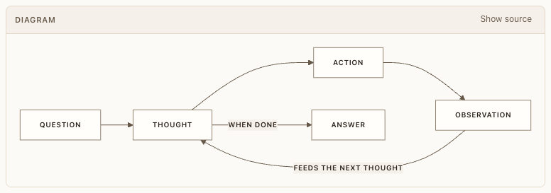

# Mermaid diagram



**Where:** Inside replies (```mermaid fences).

## Why it exists

Agents explain structure with diagrams; they render in a sandbox so diagram text can’t run code.

## Expected functionality

- Renders with the app’s colors in both themes; Show source toggles the source.
- Sized to its content; text stays legible (see [diagram lint](../agent-apps/diagram-lint.md)).
- A diagram Mermaid can’t draw shows “This diagram couldn’t be drawn” and keeps Show source; Postbox sends Mermaid’s message and line to the agent once, as a lint turn, so it can fix the diagram.
- Works in the Claude desktop browser pane.

## Steps to reproduce

1. Run the demo (`node tools/demo.mjs --port 4180`) and open <http://127.0.0.1:4180/> while it plays; keep the tab open.
2. Open “ReAct, step by step”, toggle Show source, switch light/dark.

3. For a broken diagram, run `node tools/check-feedback.mjs`: it has an agent send one and checks that the agent hears back.

**Pass if:** The diagram renders in both themes and the source toggles, and a broken diagram reaches its agent once.
