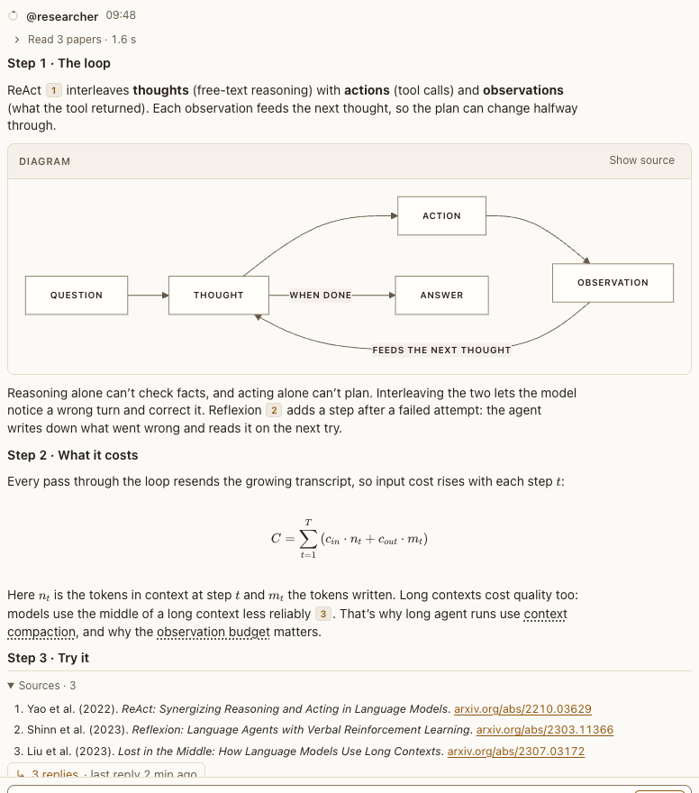

# Message actions

**Where:** Under every message in a conversation.

## Why it exists

Starting a topic thread must be discoverable without hovering. And a message needs an address the person can keep, reload or share, so a place in a long conversation isn’t lost (#168). An agent given one reads the message by the `it_…` id in it, with `read_message`.

## Expected functionality

- Reply in thread is always visible under every finished message.
- Once a thread exists, it becomes “N replies · last reply …” with an unread badge.
- Copy link, under every finished message, copies the message’s address: its conversation’s or thread’s, with `?m=` and the message’s id (#168). Opened, a reload, Back or a new tab included, it scrolls the message into view, focuses it and outlines it for a moment. One that names a message the thread doesn’t have opens the thread and says “That message isn’t here”.
- Going to what an agent needs (⌃J, “Next that needs you”, a pulsing ring) goes to its ask’s address, so Back returns to where you were, and opens the Work left open in that conversation when the window has room for it beside the conversation. The ask is focused, not a reaction under it.
- In a topic thread, each reply has Send to conversation. It waits for its answer after one click, so a double click posts once, and the reply then shows “Sent to the conversation” instead. A reply that went back as a summary shows it too (#93).

## Steps to reproduce

1. Run the demo (`node tools/demo.mjs --port 4180`) and open <http://127.0.0.1:4180/> while it plays; keep the tab open.
2. Choose Reply in thread under an agent reply; send a message in the panel; close the panel.
3. Run `npx playwright test transcript` (`tests/browser/transcript.spec.mjs`): it double-clicks Send to conversation and checks one post.
4. Under an early message, press Copy link, then paste the address in a new tab: it opens on that message. Press ⌃J with an agent waiting on you, then Back.
5. Run `npx playwright test message-address` (`tests/browser/message-address.spec.mjs`).

**Pass if:** The link shows the reply count and reopens the thread, nothing from the thread is posted twice, a copied message address opens on its message, and Back after ⌃J returns.

## Related

- [topic thread panel](../panels/topic-thread-panel.md)
