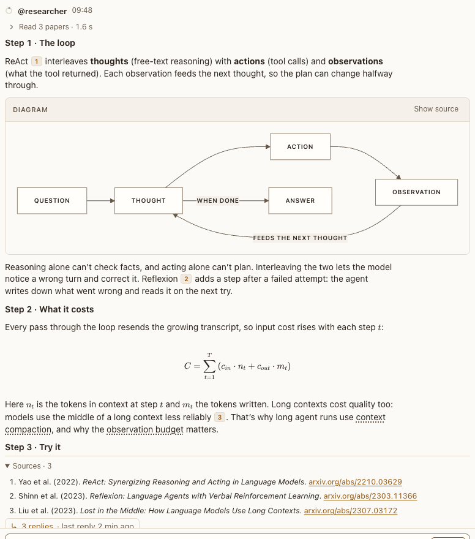

# Message actions

**Where:** Under every message in a conversation.

## Why it exists

Starting a topic thread must be discoverable without hovering.

## Expected functionality

- Reply in thread is always visible under every finished message.
- Once a thread exists, it becomes “N replies · last reply …” with an unread badge.
- In a topic thread, each reply has Send to conversation. It waits for its answer after one click, so a double click posts once, and the reply then shows “Sent to the conversation” instead. A reply that went back as a summary shows it too (#93).

## Steps to reproduce

1. Run the demo (`node tools/demo.mjs --port 4180`) and open <http://127.0.0.1:4180/> while it plays; keep the tab open.
2. Choose Reply in thread under an agent reply; send a message in the panel; close the panel.
3. Run `npx playwright test transcript` (`tests/browser/transcript.spec.mjs`): it double-clicks Send to conversation and checks one post.

**Pass if:** The link shows the reply count and reopens the thread, and nothing from the thread is posted twice.

## Related

- [topic thread panel](../panels/topic-thread-panel.md)
