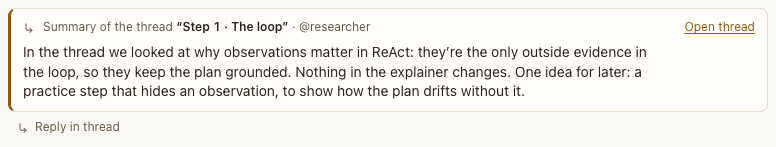

# Shared from a thread

**Where:** In a conversation, after Send to conversation or Summarize back.

## Why it exists

Results from a side topic come back to the main conversation only when you choose.

## Expected functionality

- Shows “From the thread …” or “Summary of the thread …”, who wrote it, the text, and Open thread.
- The conversation’s agents read it at the start of their next turn; it doesn’t wake them.

## Steps to reproduce

1. Run the demo (`node tools/demo.mjs --port 4180`) and open <http://127.0.0.1:4180/> while it plays; keep the tab open.
2. After scene 4c, check the summary in “ReAct, step by step”.

**Pass if:** The summary is in the conversation and links to its thread.
