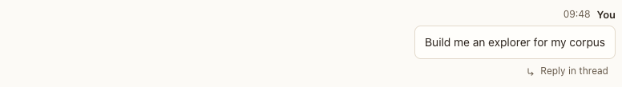

# Your message

**Where:** Right-aligned in the transcript.

## Why it exists

Your turns must be distinct from the agents’ at a glance.

## Expected functionality

- Right-aligned card with time and “You”; Markdown rendered; @mentions highlighted; attachments as chips.
- Turns typed in an attached Claude Code terminal say “from terminal”.
- Reply in thread is always visible under it.

## Steps to reproduce

1. Run the demo (`node tools/demo.mjs --port 4180`) and open <http://127.0.0.1:4180/> while it plays; keep the tab open.
2. Send “**bold** and @indexer” in a conversation.

**Pass if:** Bold renders, the mention is highlighted and wakes @indexer.

## Related

- [message actions](message-actions.md)
