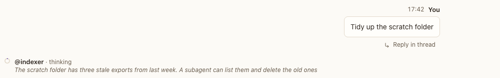

# Working row

**Where:** At the end of the conversation, while an agent is thinking or calling tools.

## Why it exists

A moving ring alone doesn’t say what the agent is doing. This row says it in a line, while it happens, and goes away when it’s done.

## Expected functionality

- One row per agent in the conversation that’s thinking or calling tools: its ring, name, and state, plus the current step while it calls a tool.
- Below that, its latest one or two sentence-boundary stretches of thinking (real agents send summarized thinking), or of a subagent’s progress, updated a few times a second. The glimpse is at most three lines, never starts with an ellipsis, and ends with one only when a long stretch is cut (#478).
- Then a line per subagent at work, attributed: its latest narration in quotes (“general-purpose: “The word count came back as 3.””), else its current step (#73).
- The row goes away while the agent writes its reply, since the reply shows then, and when the turn ends.
- The rows sit in the message column: the ring lines up with the @name of the messages above, at 1280 px with and without the thread panel. A long step stays on one line and ends with an ellipsis inside the column (#83).

## Steps to reproduce

1. Run the demo (`node tools/demo.mjs --port 4180 --speed 3`) and open <http://127.0.0.1:4180/> while it plays.
2. Scene 10b (“Tidy the workspace”): watch the end of the conversation, and the agent’s row in the sidebar’s Agents section.
3. Run Postbox with real agents and ask for something that takes thought, such as “Plan how you’d split the corpus into chapters, then do it.”
4. Run `npx playwright test transcript glimpse` (`tests/browser/transcript.spec.mjs` and `tests/browser/glimpse.spec.mjs`): they measure the row’s position, step truncation, sentence-boundary glimpse and scroll following at 1280 and 375 px.

**Pass if:**
- The row appears within a second of sending, and shows readable thinking.
- The glimpse starts at a sentence boundary, stays within three lines at 1280 and 375 px, and marks a cut at its end with an ellipsis.
- Updating the glimpse while the view is at the end keeps the view at the end.
- It names the step while a tool runs.
- It disappears once the reply starts streaming, and after the turn.
- It starts at the same left edge as the messages, not at the edge of the pane.

## Related

- [Activity line](activity-line.md)
- [Agent reply](agent-reply.md)
- [Following the newest message](following.md)
