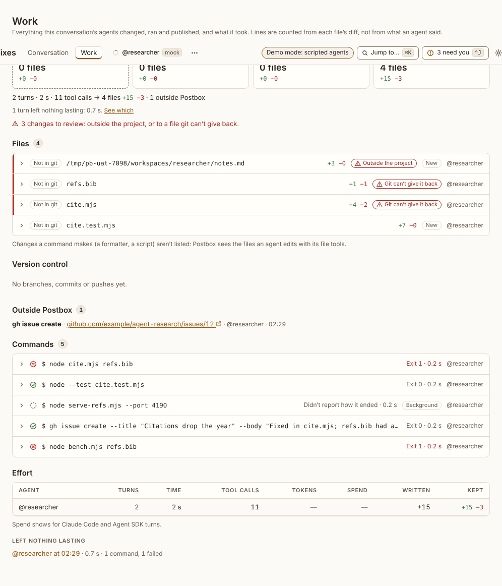
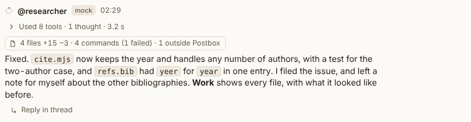

# Work view

**Where:** The conversation’s right pane (`#/t/<id>?work`, or `#/t/<id>/side/<thread>?work` beside a thread), opened by **Work** in the top bar, the conversation’s ⋯ › Work, or the line on top of the list under a turn’s last reply (“4 files +15 −3 · 4 commands (1 failed) · 1 app · 23 s in all · $0.31”, the turn’s elapsed time said as such, #214), which opens it at that turn (`&turn=<id>`). Each row of that list opens it full screen at its item (`&full=work&at=<entry>`). The full-screen icon in the pane’s head (the app frames’ own) shows the whole view over the window (`&full=work`). #138’s addresses, `#/t/<id>/work` and `/work/<turnId>`, open the pane.

## Why it exists

The person directs agents that edit code, run commands, commit, push and file issues. Without this view they learn the state of the work only by asking an agent to recount it, and then have to trust the recounting ([#132](https://github.com/HJeon139/postbox/issues/132)). The Work view lists everything the agents’ work touched and what it cost, from the tool calls themselves, never from what an agent said.

## Expected functionality

- **The pane:** Work opens on the right, alone or above an open thread. Together they split the pane, with a divider that moves by dragging, or by ↑ and ↓ (Home and End for either end) once it has focus. Each has a close button; closing Work puts focus back on the top bar’s **Work** button, which reads as pressed while Work is open. A reload restores what was open and where the divider was. The conversation keeps Work open until you close it: a link to it, or to one of its threads, opens Work again, except in a window under 768 px wide, where the pane would cover the conversation.
- **Compact, in the pane:** **To review** (only when something is flagged), **Files** by where they stand (uncommitted, committed but not pushed, pushed, not in git) with their counts and lines, **Commands** with how many failed (failed ones first), **Outside Postbox** with links, **Spend** (spend, turns, time and tokens, by agent, and the turns that left nothing lasting), and **Turns**, each turn’s line, newest first. Each list shows a few items and **All N**; each item opens Work full screen, at that item. Nothing in the pane moves or pulses.
- **Full screen:** everything below, over the whole window, as a dialog. Escape or the icon (now **Exit full screen**) returns to the pane, with focus on what opened it: the icon, or the item you chose. A thread in the pane has the same icon: full screen it’s the same transcript and composer at the message column’s width, and the draft, where you were and a reply that’s streaming carry on.
- **Scope:** every session in the conversation, its side and topic threads included. In a room, **All agents** or one agent.
- **Summary:** the files that are uncommitted, committed but not pushed, and pushed (and not in git, when any are), each with its file count and lines added and deleted. Then the effort: turns, wall time, tool calls, tokens and spend, and what it produced (“→ 4 files +15 −3”, with the lines written along the way when more were written than kept). Turns that tried something and left nothing lasting are counted, with a link to them. Changes to review are counted.
- **Files:** each file an agent’s Edit, Write or NotebookEdit changed. A file a command changes (a formatter, a `sed`) isn’t listed yet, and the section says so (#240). Each file has:
  - its state from git (asked when the view opens and after each turn, with read-only commands);
  - lines added and deleted, counted from the diff against the file before the agents’ first change. A file edited and put back counts as nothing. A binary file shows its sizes before and after.
  - **Outside the project** for a file outside the project’s and the agent’s folders, and **Git can’t give it back** for a file that existed before and git doesn’t track. Both are flagged with a red edge, sorted first.
  - opened: its full path, the turns that changed it with their time and spend, each change with a link to its turn, the diff, and **Restore…** (or **Remove…** for a file an agent created).
- **Restore:** a confirm says what’s written back and what’s lost. It refuses when the file changed since the agents’ last change. The conversation gets a line in your voice (“Restored refs.bib to how it was before @researcher changed it”), which the agents read on their next turn.
- **Version control:** branches made, commits (hash, message, branch, files and lines from git, pushed or not) and pushes (branch, remote, refs). A commit made inside a compound command (`… && git commit -q …`) is listed too (#156); a pull’s commits aren’t, a commit amended, reset or rebased away reads “no longer on a branch”, and one made while another conversation’s command ran in the same repository is listed in both, reading “or a command beside it”.
- **Shown in the conversation:** each app an agent showed or updated, at its version, and each block it showed, with **Show in the conversation**, which leaves full screen at that item (#195).
- **Outside Postbox:** issues, pull requests and comments written with `gh` or a connector’s write tool, each with its link.
- **Commands:** each command by its description when the agent gave one, else as it ran without a leading `cd <project folder> &&`, with its state in words and a glyph (Exit 0, Exit 2, Refused, Stopped, Running in the background, Didn’t report how it ended), its duration and who ran it (a subagent by name). Opened: the whole command and all its output. A background command shows its output file’s contents once it ends, or says it was still running when the turn ended. After you stop its agent, it says what became of it (#164): **Stop it too** reads Stopped; **Keep running** reads Running in the background, “You kept it running when you stopped its agent.”, until it ends or you stop it, and then says which.
- **Effort:** a table by agent (turns, time, tool calls, tokens, spend, lines written, lines kept). Kept lines count toward the agent that changed a file last, so the rows add up to the total. Spend shows for Claude Code and Agent SDK turns, and “—” for the mock. Then **Left nothing lasting**, each turn with what it tried.
- **Reads:** each file an agent read and each page it fetched or searched for, by agent, with when (#195).
- **A turn’s list** (in the transcript, #195): under the turn’s last reply, or its last block when it ends with one, once the turn ends. Its line of counts opens the pane at that turn (below). Then a row per file (name, +a −d, New or Deleted), app or block (title and version), commit (hash and message), push, write outside Postbox and command (its description, or the command without the project folder’s `cd`, and how it ended if not well), then one row for what it read (“Read 2 files”). After five rows, **N more** expands in place. Each row opens Work full screen at that item, and Escape comes back to the row. At 375 px a long path is cut in its folder and keeps its file name. A turn that read only has just the Reads row; a turn that did nothing has no list.
- **A turn’s line** (in the transcript): opens the pane at that turn, beside the thread if one is open, with the turn opened to its files and commands and focus on it. **Open this turn** shows that turn alone, full screen: its changes, commands, commits and spend, with **Show the whole conversation**.
- It updates live as a turn works. Everything opens and closes by keyboard; the diff, the output and the table scroll on their own, and take focus to scroll. It fits a 375 px window without scrolling sideways.

## Steps to reproduce

1. Run the demo (`node tools/demo.mjs --port 4180`) and open <http://127.0.0.1:4180/> while it plays; keep the tab open.
2. Open “Citation fixes” once @researcher has answered “Fix the citation script” and “Try a faster parser”. Check the list under each turn’s last reply, choose **N more**, and choose each row, pressing Escape after each.
3. Choose **Work** in the top bar. Read the pane, then choose `refs.bib` under **To review**. Full screen, open the background command and the failed one.
4. Choose **Restore…** on `refs.bib`, then **Restore**. Press Escape.
5. Open a topic thread from the first reply, then choose the second reply’s line. Drag the divider, then move it with ↑ and ↓. Reload.
6. Type a reply in the thread without sending it, scroll it up, and choose its full-screen icon. Send a message from there and watch the reply stream, then press Escape.
7. Narrow the window to 375 px and repeat steps 3, 5 and 6.
8. With a real agent in a git repository you can lose, ask it to edit a file, run a failing command, commit on a new branch and push to a local bare remote (`git init --bare /tmp/remote.git`). Open Work, and compare its files and lines with `git diff --stat` and `git show --stat`.

**Pass if:**
- The pane lists `notes.md`, `refs.bib` and `cite.mjs` under **To review**, the files by state, “5 commands · 2 failed”, the issue under **Outside Postbox**, and two turns. `refs.bib` opens full screen, already open with its diff, and Escape returns focus to `refs.bib` in the pane.
- The second reply’s line opens Work above the thread, at that turn, with focus on it; the reload brings back both, the divider where you left it.
- The thread full screen reads at the message column’s width, keeps the unsent reply and the message you were reading, streams the new reply, and comes back to the pane as it was.
- At 375 px nothing scrolls sideways, and the top bar’s **Work** stays in reach above the pane.
- The first turn’s line, under its last reply, reads “4 files +15 −3 · 4 commands (1 failed) · 1 app · 1 outside Postbox · N s in all”, over rows for the four files, “Citation preview · v1”, the issue, the four commands and “Read 2 files”; the second’s reads “1 command (1 failed) · N s in all”. The activity line above a reply says its time as “N s in tools”. Each row opens Work at that item, and Escape puts focus back on the row.
- `notes.md` is outside the project; `refs.bib` and `cite.mjs` can’t be given back by git; the diff of `refs.bib` shows `yeer` replaced by `year`.
- After Restore, `refs.bib` has `yeer` again on disk, reads **Put back**, and the conversation has the line in your voice.
- The second turn is listed under **Left nothing lasting**, and **Open this turn** on it shows only the benchmark command.
- With the real agent: the counts match git’s, the commit is listed with its branch and **Pushed**, and the branch is listed as made.
- With the real agent, a `sed -i` across three files and `git add -A && git commit -q -m …` in one command list the commit, with its three files (#156). The files under the command are #240’s.

## Related

- [Activity line](transcript/activity-line.md)
- [Command item (!)](transcript/command-item.md)
- [Conversation menu](../shell/top-bar/conversation-menu.md)
