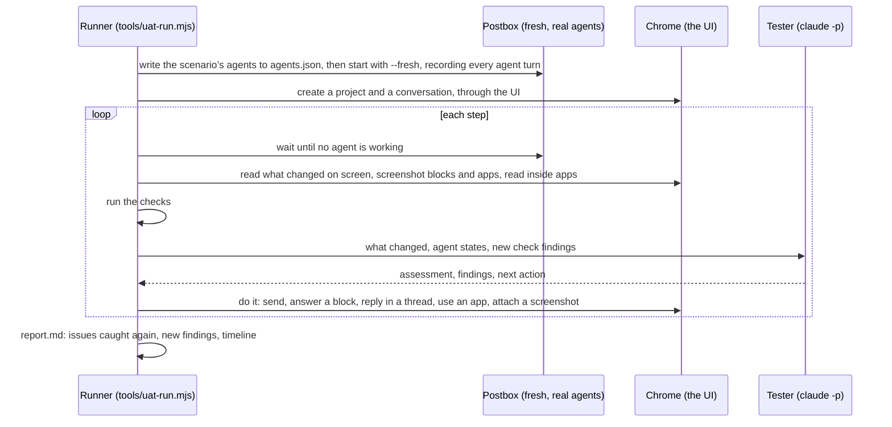

# End-to-end UAT

The component docs one level up check each part of the interface against the demo’s mock agent. This UAT checks the product as a whole: real agents, real data and a real browser, through a long piece of work, the way the defects in the issue tracker were found. A tester model plays the person, and deterministic checks run alongside it.

**It’s working when a run catches the defects already reported on GitHub.** Each report ends with a coverage table: which open issues the run caught again, and which ones a check watches for but didn’t see.

## How a run works



- **The driver** ([`tools/uat/driver.mjs`](../../../tools/uat/driver.mjs)) uses the UI the way a person does, with real clicks, key presses, typing and the file picker. It reads only what’s on screen, and reaches inside agent apps’ sandboxed frames to read and click them.
- **The tester** ([`tools/uat/tester.mjs`](../../../tools/uat/tester.mjs)) plays the person in the scenario. It sees each step’s changes, with screenshots, and judges them: broken UI, errors, anything hidden or unreadable, and agents doing the wrong thing. It picks the next action, and matches what it finds to open issues. It runs on your signed-in `claude` CLI, isolated from your own Claude Code settings.
- **What waits on the person.** Every step, the runner lists what “needs you” would count: blocks that ask and aren’t answered (review drafts included, whatever revision they’re on), wake requests, proposals, permission cards and failed turns. The tester answers them before it moves to the next phase or finishes. If it tries to move on, or to wait while no agent works, the runner holds the action once and says what’s still waiting. A review is answered with the `review` action: approve, or request changes with at least one comment on a line. The report lists anything left waiting at the end.
- **Settings.** The `settings` action opens Settings › Personas and edits an agent, and with `permissions` its permissions panel too. The tester gets their text, what their fields hold (backend, model, checkboxes) and screenshots, and the run closes them after.
- **The checks** ([`tools/uat/checks.mjs`](../../../tools/uat/checks.mjs)) catch defect classes deterministically from:
  - Postbox’s state and the page
  - every agent turn’s raw stream
  - the agents’ Claude Code transcripts
  - probes of the UI

## The checks, and what they reproduce

| Check                        | Issue | Looks for                                                                                                                                                                                     |
| ---------------------------- | ----- | --------------------------------------------------------------------------------------------------------------------------------------------------------------------------------------------- |
| fresh-install-agents         | #43   | A fresh install seeding use-case agents, or more than one agent or a sample project (from `server/seed.mjs`)                                                                                  |
| hidden-turn-error            | #61   | A failed turn whose error gives no reason                                                                                                                                                     |
| refusal-without-card         | #65   | Calls Claude Code refused (the result’s `permission_denials`) with no card in the conversation                                                                                                |
| settings-leak                | #57   | The person’s output style, or a line of their global CLAUDE.md, in agent turns                                                                                                                |
| tool-not-allowed             | #5    | A real agent’s tools include one its persona doesn’t tick, or one that acts outside Postbox (SendMessage, CronCreate…)                                                                        |
| mcp-servers-missing          | #59   | The person’s MCP servers absent from the agents’ `init`                                                                                                                                       |
| mcp-side-channel             | #54   | A Bash command posting to `/mcp?session=`                                                                                                                                                     |
| prose-instead-of-block       | #63   | A turn ending in questions or numbered options, or a long draft, with no choice, form, review or confirm block. It also counts the replies that used the right block (M1’s exit check, below) |
| lint-on-person-term          | #55   | A lint turn defining a term the person wrote                                                                                                                                                  |
| topic-relints-parent-term    | #56   | A topic thread re-defining its conversation’s terms                                                                                                                                           |
| diagram-error-not-fed-back   | #46   | A diagram that failed to draw                                                                                                                                                                 |
| app-shows-missing-data       | #47   | An app whose only content is a missing-data message                                                                                                                                           |
| unreadable-app-marks         | #53   | Most SVG marks under 4 px, or labels under 9 px, inside an app                                                                                                                                |
| status-colors-for-categories | #52   | App code coloring with `--good`/`--alert` and none of `--s1`…`--s8`                                                                                                                           |
| updated-app-far-up           | #49   | A new app version still far above the latest message                                                                                                                                          |
| version-menu-overflow        | #36   | An app with 15 or more versions                                                                                                                                                               |
| check-starved                | #37   | An app check that timed out                                                                                                                                                                   |
| full-screen-noop             | #45   | Expand leaving the app frame the same size                                                                                                                                                    |
| image-not-shown              | #48   | An attached image shown as a file chip                                                                                                                                                        |
| review-table-raw             | #62   | A Markdown review block with a table                                                                                                                                                          |
| stale-progress               | #58   | A progress step still running after its agent stopped                                                                                                                                         |
| silent-while-working         | #68   | Agents thinking or calling tools with no working row on screen                                                                                                                                |
| model-not-shown              | #60   | No model name in the top bar                                                                                                                                                                  |
| kiro-settings-leak           | #57   | An Isolated Kiro agent’s turn that loaded steering files (its stream’s `steering_inclusion`)                                                                                                  |
| kiro-mcp-leak                | #57   | An Isolated Kiro agent’s call to an MCP server other than Postbox’s that completed, such as one a managed install adds by itself                                                              |
| kiro-refusal-not-shown       | #65   | A call Kiro refused (an ask no one could answer headless, or a deny rule) with no refused step under its id in the conversation                                                               |
| kiro-tool-not-allowed        | #5    | A Kiro command or fetch that ran when the persona doesn’t tick `shell` or `web.fetch`                                                                                                         |
| failed-turn, page-errors     | (new) | Any other failed turn, and console errors                                                                                                                                                     |

When a defect is filed from a run, add a check for it here if it can be caught deterministically, so later runs keep watching for it.

## Scenarios

- [SciFact: claims, abstracts and retrieval](scenarios/scifact.md)
- [HotpotQA: renaming entities to test RAG memorization](scenarios/hotpotqa.md)
- [Mixed room: a Claude Code agent and a Kiro CLI agent](scenarios/mixedroom.md) ([#117](https://github.com/HJeon139/postbox/issues/117)): the researcher on Claude Code, the critic on the Kiro CLI with a GPT model; options, a second opinion, wakes both ways, and a topic thread where the Kiro agent is refused a command
- [Codex: persistent turns, MCP and a topic fork](scenarios/codex.md) ([#144](https://github.com/HJeon139/postbox/issues/144)): resume a Codex app-server thread, call a Postbox tool, branch a topic thread, approve a command and stop a long turn
- M1’s exit check ([#64](https://github.com/HJeon139/postbox/issues/64)), below:
  - [Wiki search: picking an approach](scenarios/wikisearch.md): a question with several reasonable answers
  - [Launch announcement: a draft to approve](scenarios/announcement.md)
  - [Paper survey: a job that takes minutes](scenarios/papersurvey.md)

A scenario is Markdown:
- a title
- settings: the persona the tester plays, the agents, the project and the conversation’s name. A fresh install has only @assistant, so the runner seeds the scenario’s agents from [`personas.json`](personas.json), through `agents.json` in the run’s data folder. Since #5, a real agent can use only the tools its persona ticks, so both personas tick `shell` and `web.fetch`: they keep the commands and web access they had before, and a run on this branch differs from `main` only in what agents are told.
- optionally, `backends`: agents to run on another backend, with a model, such as `critic=kiro-cli:gpt-5.6-terra`. Agents it doesn’t name run on the default backend, Claude Code. A Kiro agent is Isolated, with Postbox’s own Kiro home, so a run never writes into your `~/.kiro`. Codex scenarios use your local Codex sign-in and configuration; install and sign in to Codex first, or set `POSTBOX_CODEX_BIN`.
- a summary
- one `## Phase` section per phase, in the person’s words

Each phase tells the tester what to ask for, what to expect, and which parts of the UI to exercise.

### M1’s exit check: agents pick blocks without being asked

The three exit scenarios are short: two phases each, with @researcher. In each, the person’s reply calls for a block (options to pick from, a draft to approve, a long job), and the person never asks for one or names one. A test (`tests/uat-checks.test.mjs`) keeps block names out of them.

The `prose-instead-of-block` check counts, over a run, the replies that called for a block and the ones that used the right one. What the person asked for and what the agent did decide the block a turn calls for:

| A turn with | Calls for          | Counted from                                                                                                                                                                                                          |
| ----------- | ------------------ | --------------------------------------------------------------------------------------------------------------------------------------------------------------------------------------------------------------------- |
| A long job  | a progress block   | a progress block in the turn, or a job of several steps: 10 or more tool calls, or 2 minutes or more with 3 or more. Minutes spent only writing aren’t a job.                                                         |
| A draft     | a review block     | a review block in the turn, or a draft in the prose (8 or more lines that don’t just point at a block) when the person asked for something to approve, or the agent asks them to. A report or a result isn’t a draft. |
| Options     | a choice           | two or more list items, with a question asking the person to pick (which, choose, prefer…) that isn’t itself a list item                                                                                              |
| Questions   | a form or a choice | three or more questions to the person in the reply’s last lines                                                                                                                                                       |
| A decision  | a confirm          | the confirm itself                                                                                                                                                                                                    |

Practice questions (inside `<details>`, or under a Practice or Exercise heading) ask nothing of the person, and a reply to Postbox’s own lint message doesn’t count. The rules were checked against the first wave 2 runs: `tests/fixtures/uat/m1-turns.json` holds real turns from them, and a test keeps them reading the way a person judges them (a long job with a progress block and a table is right; a long explanation and a plan after “approved” call for nothing).

A turn is **right** only if everything it called for has one of its blocks: a choice doesn’t cover a draft, and a long job without a progress block isn’t right, whatever else the turn showed. The #63 findings stay as they were: one per reply that put options, questions or a draft in prose with no asking block.

The counts are information, not a defect. They’re one finding with no issue, titled “M1 exit check: 3 of 4 replies that called for a block used the right one”, with the split in its evidence (“3 right (choice 2, review 1); 1 without the block they called for (a long job 1).”) and in `counts` in `findings.json`. It carries the verdict “measurement”, so the runner neither verifies nor files it. The report lists it under **New findings**, with “measurement: Not a defect: the block counts for M1’s exit check (#64).” in the verdict column, and the report’s last line counts it among the new findings. It isn’t listed under “Known issues caught again”. Its key carries the counts, so a live run logs each new total in `run.log` and adds a row to the table, and the last one is the run’s. `--recheck` gives one total. To compare `main` with a branch, run each scenario on both (on `main`, which doesn’t have these scenarios, pass `--scenario` the path to the branch’s file), then recheck both runs with the branch’s checks:

```bash
node tools/uat-run.mjs --scenario wikisearch
node tools/uat-run.mjs --recheck uat-runs/<run>
```

## Running it

```bash
node tools/uat-run.mjs --scenario scifact
```

Options:
- `--steps` (30 to 40 for a full run)
- `--turn-timeout` (seconds per agent turn, default 900)
- `--budget` (the tester’s spend cap, in dollars)
- `--tester-model`
- `--port`, `--chrome-port`, for two runs at once
- `--phase` (start at that phase, to rerun a later one; the tester sets up what it needs first)

A run needs Claude Code installed and signed in, Chrome, and network access for the agents’ data downloads. A scenario with Kiro agents also needs the Kiro CLI, signed in; their turns use Kiro credits, which the report lists beside the agents’ cost. It uses real usage: a data-heavy agent turn can cost a few dollars.

Each run writes to `uat-runs/<time>-<scenario>/`, which git ignores:
- `report.md`: the issues caught again, new findings, and the timeline
- `findings.json`
- `run.log`
- `shots/`: screenshots of every block and app the tester saw
- `streams/`: each agent turn’s raw stream, with Kiro turns in `streams/kiro/`
- `data/`: Postbox’s data, so a run can be reopened with `node server/index.mjs --data uat-runs/<run>/data`

File what a run finds with the bug template in the [UAT README](../README.md), after checking each finding against its screenshot.

## Filing what a run finds

New findings are filed as GitHub issues automatically, unless an open issue already covers them. After the report, the runner:
1. **Skips** findings that match an open issue. These are tagged by the tester or a check, or carry the fingerprint of an issue an earlier run filed.
2. **Verifies** the rest in a fresh model session against the screenshots and the run’s evidence. Each finding gets a verdict:
   - **confirmed:** a defect in Postbox
   - **harness:** caused by the runner
   - **not reproduced**
   - **duplicate:** an open issue covers it
   - **agent-work:** a flaw in the agent’s own reasoning that Postbox didn’t cause
3. **Files** each confirmed finding with the bug template: component, urgency, steps to reproduce, expected, and what failed instead. It gets the `uat` label, a priority from its severity, and a hidden fingerprint so later runs don’t file it again. The report shows each verdict and issue number.

Filed issues have no milestone, so they get triaged into the plan ([#64](https://github.com/HJeon139/postbox/issues/64)) like any other. Pass `--file no` to skip filing, and `--recheck uat-runs/<run>` to file from a finished run.

## Validation: 21 October 2026

The first two runs, on `main`, caught 14 of the issues already filed from real use. Each was confirmed against screenshots or the run’s saved data.

| Issue                                      | SciFact | HotpotQA | Caught by                                                                             |
| ------------------------------------------ | ------- | -------- | ------------------------------------------------------------------------------------- |
| #43 use-case agents on a fresh install     | ✓       | ✓        | check                                                                                 |
| #44 mixed fonts in apps                    | ✓       |          | check (two font stacks inside one app)                                                |
| #45 Expand isn’t full screen               | ✓       | ✓        | tester                                                                                |
| #48 images shown as file chips             | ✓       |          | check and tester                                                                      |
| #49 updated app stays far up               | ✓       |          | check and tester                                                                      |
| #53 chart labels too small to read         |         | ✓        | check (labels about 8 px)                                                             |
| #54 apps too large to send                 |         | ✓        | tester                                                                                |
| #55 lint on the person’s own term          |         | ✓        | check and tester                                                                      |
| #57 the person’s settings leak into agents | ✓       | ✓        | check and tester; an agent even published to the person’s own claude.ai artifact tool |
| #58 progress without time or staleness     |         | ✓        | tester                                                                                |
| #60 model not shown                        | ✓       | ✓        | check                                                                                 |
| #62 review tables as raw pipes             |         | ✓        | check and tester                                                                      |
| #63 questions and drafts in prose          | ✓       | ✓        | check and tester                                                                      |
| #68 nothing on screen while agents work    | ✓       | ✓        | check and tester                                                                      |

**Not triggered by these scenarios** (the checks watch for them):
- #46: no diagram failed to draw.
- #47: the agents embedded their data instead of loading it into the corpus.
- #52: the apps used the kit’s palettes.
- #56: no topic thread re-defined a term.
- #59: no MCP servers were configured on the machine.
- #61: every fork resumed.
- #65: nothing was refused.

A scenario that leans on those (a dataset too large to embed, permission-heavy work, a long topic thread) would exercise them. #50 and #51 need a hand-off from an app, which the tester didn’t make.

**What the runs found that wasn’t filed:**
- An unanswered review block keeps the agent “needs you” long after the conversation moved on.
- A review of 5 records shows 137 “Comment on line” buttons.
- Agents write `<details>` and expect it to fold, but Postbox shows agent HTML as text, and the guide doesn’t say so.

The tester also judged the agents’ work, catching a renaming that leaked identifying facts, and inconsistent counts between replies.

**What review found in the harness itself, all fixed before these numbers:**
- Sandboxed app frames couldn’t be reached.
- Item screenshots were offset, and blank beyond the window.
- KaTeX’s hidden screen-reader copy was read as garbled math.
- The tester wasn’t told when the run pressed Stop.
- The runner talked to whatever already held its port.

A run costs real usage: about $30 to $45 for agents, and $5 to $7 for the tester, over 30 to 70 minutes.

To apply improved checks to a finished run without running agents again:

```bash
node tools/uat-run.mjs --recheck uat-runs/<run>
```
