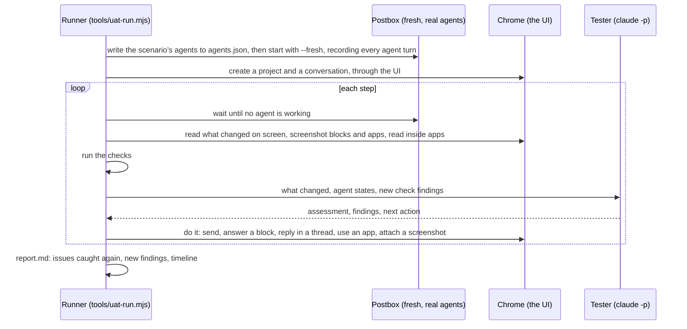
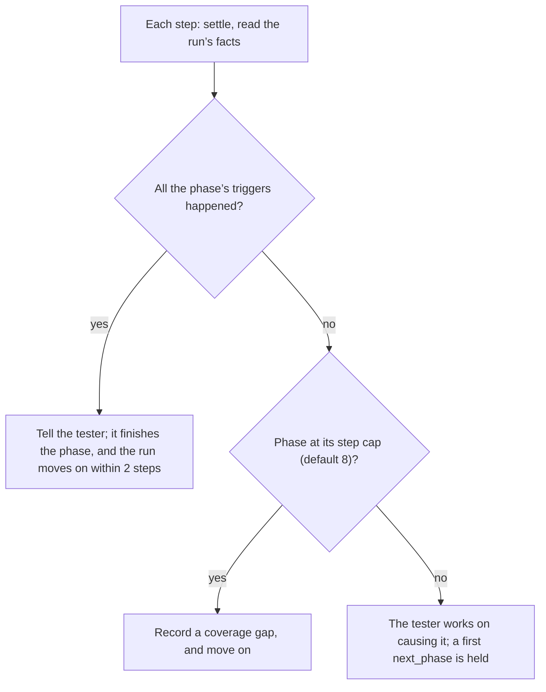

# End-to-end UAT

The component docs one level up check each part of the interface against the demo’s mock agent. This UAT checks the product as a whole: real agents, real data and a real browser, through a long piece of work, the way the defects in the issue tracker were found. A tester model plays the person, and deterministic checks run alongside it.

**It’s working when a run catches the defects already reported on GitHub.** Each report ends with a coverage table: which open issues the run caught again, and which ones a check watches for but didn’t see.

**A run confirms a fix; it doesn’t decide it.** Real agents don’t keep to an exact order of events, so an issue whose behavior depends on one names its deterministic `node:test` test in its acceptance before a paid run is planned for it, and that test decides the fix (#439, whose host runs took three tries to reach its order). A check or trigger is tested the same way: from a run’s recorded records, not from results written by hand, which can’t show what real agents and Postbox did (the hostwakes scenario’s checks, #451).

## How a run works



- **The driver** ([`tools/uat/driver.mjs`](../../../tools/uat/driver.mjs)) uses the UI the way a person does, with real clicks, key presses, typing and the file picker. It reads only what’s on screen, and reaches inside agent apps’ sandboxed frames to read and click them.
- **The tester** ([`tools/uat/tester.mjs`](../../../tools/uat/tester.mjs)) plays the person in the scenario. It sees each step’s changes, with screenshots, and judges them: broken UI, errors, anything hidden or unreadable, and agents doing the wrong thing. It picks the next action, and matches what it finds to open issues. It runs on your signed-in `claude` CLI, isolated from your own Claude Code settings.
- **What waits on the person.** Every step, the runner lists what “needs you” would count: blocks that ask and aren’t answered (review drafts included, whatever revision they’re on), wake requests, proposals, permission cards and failed turns. The tester answers them before it moves to the next phase or finishes. If it tries to move on, or to wait while no agent works, the runner holds the action once and says what’s still waiting. A review is answered with the `review` action: approve, or request changes with at least one comment on a line. The report lists anything left waiting at the end.
- **While a turn runs.** The runner waits for the agents to finish before each step, so a `send`, `thread`, `act` or `review` can carry an `interrupt`: once an agent is working, the run lets it work for a number of seconds, then presses Stop, writes a message and presses Send now on it, or answers a block (`do: answer`, with the item and the answer `review` or `act` would give). After Stop, it answers Postbox’s question about the agent’s background jobs (“Stop it too” or “Keep running”, #126) if one appears, and the `jobs` action answers one left on screen. `send_then_stop` sends a message, waits the seconds the tester gave (up to five minutes, the `wait` action’s cap), with the checks below running meanwhile, presses Stop, and passes Postbox’s question about background jobs to the tester, or says the reply had already finished; the interrupt goes in `findings.json`’s probes and in `run.log`. The wait before a step ends early, once for each, when something needs the person while an agent still works (#289): Stop’s question at once, since it keeps the turn running until it’s answered, and a block that asks once its turn has gone on 10 seconds past it (in the recorded runs, a turn that showed one ended 2.5 to 4.3 seconds after it, on a closing line). While an agent still works, the runner holds an action that carries an `interrupt`, since it would act on that turn. A wake request is a card, answered with `act` and its button.
- **Checks while agents work.** `background-step-closed` and `two-processes-one-session` also run every 15 seconds while an agent works, and during an interrupt’s wait: on `main`, a turn with a background command lasts until the command ends, so by the next step the stream has reported its end and the step’s “done” looks right again.
- **What the tester read.** Before it answers a block, the runner checks that the block is still the revision the tester read. If an agent changed it meanwhile, it doesn’t answer, and tells the tester to read it again, as a person would see it change. It notes the revision it answered, for `approval-for-other-revision`. So that check’s “applied to another revision” half covers only the seconds the runner takes to answer; its other half, an update that erased an unread answer, covers #123’s own timeline. An answer given while the agent works (an interrupt that answers) skips that guard on purpose: the page answers the revision it showed, which is how P0’s phase 2 makes Postbox refuse a stale answer, or an update over an unread one.
- **The Agents section and the right pane.** `agent_panel` opens an agent’s quick panel from the sidebar (#105) and sets its model, effort, mode or Shell. `pane` opens Work or a thread in the right pane, `thread_reply` answers in the thread open there, `fullscreen` opens one full screen, `fullscreen_draft` checks that a thread keeps a draft and its place through full screen, and `restore` restores a file from Work (#146, #138). Each records what it saw, for the checks below.
- **Which model the agents run on.** A run puts its Claude agents on `--agent-model` with `--agent-effort` (default `claude-haiku-5-5`, `low`): an integration pass checks that Postbox works, and a fast model shows that much faster. A scenario that measures what agents choose, such as M1’s exit scenarios, says `- models: persona` and keeps personas.json’s model and effort; so does `--agent-model persona --agent-effort persona` for any run. `--force-agent-model` puts even a `models: persona` scenario’s Claude agents on `--agent-model` and `--agent-effort`, for an integration pass that can’t spend the personas’ model. The report’s first lines name the model the agents ran on, so such a run doesn’t measure what the personas’ model would choose. The report’s first lines say what the agents ran on. The tester stays on `--tester-model` (Sonnet), since it judges and files.
- **The workspace is a git repository of its own**, so an agent’s commits never land in the Postbox checkout the run sits in. Its project settings exclude the checkout’s `AGENTS.md` files (`claudeMdExcludes`), which Claude Code would otherwise read from every folder above an agent’s: they’re the rules for developing Postbox, not for the scenario’s project (#315).
- **Settings.** The `settings` action opens Settings › Personas and edits an agent, and with `permissions` its permissions panel too. The tester gets their text, what their fields hold (backend, model, checkboxes) and screenshots, and the run closes them after.
- **The checks** ([`tools/uat/checks.mjs`](../../../tools/uat/checks.mjs)) catch defect classes deterministically from:
  - Postbox’s state and the page
  - every agent turn’s raw stream, with when its process started and last wrote
  - Postbox’s events for items and sessions, in order, followed from the server’s event stream (`tools/uat/history.mjs`): what was answered and updated when, which the state alone doesn’t keep
  - the agents’ Claude Code transcripts
  - probes of the UI

## The checks, and what they reproduce

| Check                        | Issue | Looks for                                                                                                                                                                                                                                                                                                                                                                  |
| ---------------------------- | ----- | -------------------------------------------------------------------------------------------------------------------------------------------------------------------------------------------------------------------------------------------------------------------------------------------------------------------------------------------------------------------------- |
| fresh-install-agents         | #43   | A fresh install seeding use-case agents, or more than one agent or a sample project (from `server/seed.mjs`)                                                                                                                                                                                                                                                               |
| hidden-turn-error            | #61   | A failed turn whose error gives no reason                                                                                                                                                                                                                                                                                                                                  |
| refusal-without-card         | #65   | Calls Claude Code refused (the result’s `permission_denials`) with no card in the conversation                                                                                                                                                                                                                                                                             |
| settings-leak                | #57   | The person’s output style, or a line of their global CLAUDE.md, in agent turns                                                                                                                                                                                                                                                                                             |
| tool-not-allowed             | #5    | A real agent’s tools include one its persona doesn’t tick, or one that acts outside Postbox (SendMessage, CronCreate…)                                                                                                                                                                                                                                                     |
| mcp-servers-missing          | #59   | The person’s MCP servers absent from the agents’ `init`                                                                                                                                                                                                                                                                                                                    |
| mcp-side-channel             | #54   | A Bash command posting to `/mcp?session=`                                                                                                                                                                                                                                                                                                                                  |
| prose-instead-of-block       | #63   | A turn ending in questions or numbered options, or a long draft, with no choice, form, review or confirm block. It also counts the replies that used the right block (M1’s exit check, below)                                                                                                                                                                              |
| agents-section-members       | #105  | An agent in the conversation with no row in the sidebar’s Agents section                                                                                                                                                                                                                                                                                                   |
| topbar-title-cut             | #105  | The top bar cutting the conversation’s title or project at 1200 px or wider                                                                                                                                                                                                                                                                                                |
| quick-panel-takes-effect     | #105  | A model picked in the quick panel that the agent’s next turn doesn’t run                                                                                                                                                                                                                                                                                                   |
| shell-off-silent             | #104  | A command refused after Shell was turned off, with no refused step or card                                                                                                                                                                                                                                                                                                 |
| work-files-match-stream      | #132  | A file an agent changed with Edit or Write that the Work view doesn’t list                                                                                                                                                                                                                                                                                                 |
| work-commands-match-stream   | #132  | A Bash command an agent ran that the Work view doesn’t list                                                                                                                                                                                                                                                                                                                |
| pane-split                   | #146  | A thread and Work open together, with one of them under 120 px tall                                                                                                                                                                                                                                                                                                        |
| fullscreen-keeps-draft       | #146  | A thread that loses its draft, or its place, going full screen and back                                                                                                                                                                                                                                                                                                    |
| needs-jump-missed            | #285  | Going to what an agent needs (the global button, or its ring or row) that focused another ask, nothing, an ask off screen, or one not outlined                                                                                                                                                                                                                             |
| lint-on-person-term          | #55   | A lint turn defining a term the person wrote                                                                                                                                                                                                                                                                                                                               |
| topic-relints-parent-term    | #56   | A topic thread re-defining its conversation’s terms                                                                                                                                                                                                                                                                                                                        |
| diagram-error-not-fed-back   | #46   | A diagram that failed to draw                                                                                                                                                                                                                                                                                                                                              |
| app-shows-missing-data       | #47   | An app whose only content is a missing-data message                                                                                                                                                                                                                                                                                                                        |
| unreadable-app-marks         | #53   | Most SVG marks under 4 px, or labels under 9 px, inside an app                                                                                                                                                                                                                                                                                                             |
| status-colors-for-categories | #52   | App code coloring with `--good`/`--alert` and none of `--s1`…`--s8`                                                                                                                                                                                                                                                                                                        |
| updated-app-far-up           | #49   | A new app version still far above the latest message                                                                                                                                                                                                                                                                                                                       |
| version-menu-overflow        | #36   | An app with 15 or more versions                                                                                                                                                                                                                                                                                                                                            |
| check-starved                | #37   | An app check that timed out                                                                                                                                                                                                                                                                                                                                                |
| full-screen-noop             | #45   | Expand leaving the app frame the same size                                                                                                                                                                                                                                                                                                                                 |
| image-not-shown              | #48   | An attached image shown as a file chip                                                                                                                                                                                                                                                                                                                                     |
| review-table-raw             | #62   | A Markdown review block with a table                                                                                                                                                                                                                                                                                                                                       |
| stale-progress               | #58   | A progress step still running after its agent stopped                                                                                                                                                                                                                                                                                                                      |
| silent-while-working         | #68   | Agents thinking or calling tools with no working row on screen                                                                                                                                                                                                                                                                                                             |
| model-not-shown              | #60   | No model name in the sidebar’s Agents section                                                                                                                                                                                                                                                                                                                              |
| kiro-settings-leak           | #57   | An Isolated Kiro agent’s turn that loaded steering files (its stream’s `steering_inclusion`)                                                                                                                                                                                                                                                                               |
| kiro-mcp-leak                | #57   | An Isolated Kiro agent’s call to an MCP server other than Postbox’s that completed, such as one a managed install adds by itself                                                                                                                                                                                                                                           |
| kiro-refusal-not-shown       | #65   | A call Kiro refused (an ask no one could answer headless, or a deny rule) with no refused step under its id in the conversation                                                                                                                                                                                                                                            |
| kiro-tool-not-allowed        | #5    | A Kiro command or fetch that ran when the persona doesn’t tick `shell` or `web.fetch`                                                                                                                                                                                                                                                                                      |
| two-processes-one-session    | #126  | Two turns of one Claude Code session whose streams overlap in time, or Postbox tool calls a stopped turn’s process made after Stop that Postbox didn’t refuse                                                                                                                                                                                                              |
| background-step-closed       | #126  | A background Bash call (`run_in_background`, or moved to the background) whose step shows done while its stream hasn’t reported the job’s end; with #126’s fix, while the session’s job record still says it runs (#129’s part that #126 takes)                                                                                                                            |
| duplicate-block-id           | #125  | One session with two blocks that have the same id in a conversation                                                                                                                                                                                                                                                                                                        |
| approval-for-other-revision  | #123  | An answer applied to a revision other than the one the person was answering, or an update that reopened an answered block before the agent had a turn to read the answer                                                                                                                                                                                                   |
| wake-text-clipped            | #108  | An allowed wake whose delivered message is shorter than what the agent sent                                                                                                                                                                                                                                                                                                |
| agy-refusal-not-shown        | #65   | A call Antigravity refused (on its step, or only in the result’s `denied_actions`) with no refused step under its id. Release runs only                                                                                                                                                                                                                                    |
| agy-postbox-refused          | #143  | A call to Postbox’s own tools that Antigravity refused: the allow rule is missing from the agy settings. Release runs only                                                                                                                                                                                                                                                 |
| agy-tool-not-allowed         | #5    | An Antigravity command or fetch that ran when the persona doesn’t tick `shell` or `web.fetch`: agy can’t turn them off, so the agent ignored being told. Release runs only                                                                                                                                                                                                 |
| ran-on-its-host              | #120  | Host mode: a turn of an agent placed on a host with no remote turn on that host in Postbox’s state or history, or a turn of an agent here with one                                                                                                                                                                                                                         |
| host-turns-listed            | #120  | Host mode, at the end: a turn Postbox recorded on a host that isn’t in its `~/.postbox-remote/turns`, or one there Postbox never recorded (read over the runner’s own ssh)                                                                                                                                                                                                 |
| host-done-when               | #120  | Host mode, at the end: Postbox still running on a host after its idle timeout, or `~/.postbox-remote` still there, or anything of Postbox running, after Remove                                                                                                                                                                                                            |
| host-listeners               | #120  | Host mode: a TCP listener of the run’s own processes, there during a turn and not before setup (`ss` on the host, `lsof` here)                                                                                                                                                                                                                                             |
| remote-stop-left-processes   | #120  | Host mode: a turn Stop ended that left processes on its host, or Stop that didn’t say beforehand that a background job there stops with the turn                                                                                                                                                                                                                           |
| fault-not-recovered          | #120  | Host mode: a host that didn’t read Connected again within 3 minutes of a fault                                                                                                                                                                                                                                                                                             |
| attachment-laptop-path       | #120  | Host mode: an agent on a host given a path in this computer’s Postbox data, which it can’t read                                                                                                                                                                                                                                                                            |
| host-install-offered         | #120  | Host mode: a host just added whose card offers no Install…                                                                                                                                                                                                                                                                                                                 |
| failed-turn, page-errors     | (new) | Any other failed turn, and console errors                                                                                                                                                                                                                                                                                                                                  |
| telemetry-leak               | —     | Any canary, in any encoding the seed covers (base64, a third of it, hex, look-alike letters, zero-width spaces, spelled-out digits); any file path, command line, handle, block id or instruction line; or five words in a row from the room, in a saved telemetry report, its `run.json` and `findings.json`, or the text File issue copied. Uses none of the gate’s code |
| recording-visible            | —     | Postbox’s own words about recording (its UI strings, or a `recording` field) in the parts of an agent’s turn input Postbox writes: `[Postbox]` lines and its tools’ results                                                                                                                                                                                                |
| telemetry-missed-finding     | —     | A check finding a live room could make in this run that the saved report doesn’t list                                                                                                                                                                                                                                                                                      |
| telemetry-gap-as-zero        | —     | A turn with a whole recorded stream that the report doesn’t count as recorded, or one without a stream that it doesn’t list as a gap                                                                                                                                                                                                                                       |
| telemetry-bytes-mismatch     | —     | A saved report whose hash the Telemetry view didn’t show at Save, or copied text File issue didn’t show                                                                                                                                                                                                                                                                    |
| flag-misplaced               | —     | A runner’s 🚩 not on the item it reacted to                                                                                                                                                                                                                                                                                                                                |
| telemetry-at-rest            | —     | A telemetry folder not `0700` or file not `0600`, or anything telemetry wrote under the project’s folder                                                                                                                                                                                                                                                                   |

When a defect is filed from a run, add a check for it here if it can be caught deterministically, so later runs keep watching for it.

## Scenarios

- [SciFact: claims, abstracts and retrieval](scenarios/scifact.md)
- [HotpotQA: renaming entities to test RAG memorization](scenarios/hotpotqa.md)
- [Diagnosis: tracing a failure to a different CLI environment](scenarios/diagnosis.md), a focused reproduction with fake settings and no network or real credentials. It checks whether an agent compares the exact failing command with a working one-factor variant before asking the person to change their setup.
- [P0 hotfixes](scenarios/p0.md) (#108, #123, #125, #126), a targeted scenario (see “How long a run is”): two Claude Code agents in a room. Phase 1 has them trade a 15-item checklist, and then only their changes, through more than ten wakes, so the allow card appears (#108, #320). Phase 2 makes the draft change under you: you answer it while its agent revises it, answer a revision that has since changed, and ask for it again under the same id (#123, #125). Phase 3 has a background command, then Stop with Keep running, Stop with Stop it too, and Send now (#126).
- [Telemetry: recording a room after something goes wrong](scenarios/telemetry.md), a targeted scenario for telemetry ([`designs/telemetry-persona.md`](../../../designs/telemetry-persona.md), “End-to-end UAT”). The tester starts recording late in a room whose project holds this run’s canaries (`- seed: canaries`), reacts 🚩 and 👎 to two messages while an agent writes a line meant to fool the report, then asks for a report on the whole room, leaves out a line, saves it, and presses File issue with no `gh` (`- gh: none`). It starts recording itself (`- telemetry: manual`). Every other run records itself: the runner chooses Record this room before step 1, notes each tester finding’s newest item, reacts 🚩 to each after the last step (so no agent hears it), and saves one report with the history, copied to `telemetry/report.json`. The report’s labels go on the run’s findings as `telemetry: { mast, area, attribution, confidence }`, its proposals under `findings.json`’s `telemetry`, never filed, and `run.json` gets a `telemetry` block (recall, pinning, unlabeled share, proposals, cost) that `tools/uat-stats.mjs` totals. `--telemetry no` opts out.
- [Remote hosts: three agents on three machines](scenarios/remotehosts.md) (#120), a targeted scenario for host mode only (“Host mode”, below): @researcher on host1, @critic on host2 and @developer here. Phase 1 has a turn on each machine, a block, a review and a permission card answered after a minute; phase 2 an attachment to an agent on a host, agents waking each other across machines, and Stop on a host; phase 3 the three faults, one of them while a permission card waits.
- [Allow once: a command auto mode refused, run again, and a chained one no rule can allow](scenarios/allowonce.md) (#238, #280), a targeted scenario, about 10 steps. The runner seeds the project with a `.env`, and one in `sub`, holding only a fake value it made up (`- seed: fake-env`). @researcher, in auto mode, is asked what the project’s settings are set to, without the person naming the file or the setting, so the classifier refuses the read (printing a credential is blocked by default unless you named it, and the classifier doesn’t see the output; an earlier run’s `git remote add` went through unrefused). The refusal has to be the classifier’s, by its card and by its stream (`permission_denied`, or the call’s `permission_decision`); otherwise the coverage table says #238 went untested, and the tester stops without pressing Allow once. Allow once has to run the byte-identical command on the retry, let through by its rule rather than by the classifier (`reason_type: "rule"`), and print the fake value. Then a `cd sub && …` read: its card must offer neither Allow once nor Always allow, and say why. `node tools/uat-run.mjs --scenario allowonce --budget 5 --file no`
- [Work room: real changes, the agents in the sidebar, and the right pane](scenarios/workroom.md): @researcher changes real files and @critic reviews them, through the Agents section and the Work view in the right pane. Its plan is [plan-agents-and-work.md](../plan-agents-and-work.md).
- [Needs you: going to what each agent is waiting on](scenarios/needsnav.md) ([#285](https://github.com/HJeon139/postbox/issues/285)), a targeted scenario: two agents in a room need you at once, one ask far up a long transcript and one in a topic thread, and the tester goes to each with the `go_to_needs` action: the top bar’s “Next that needs you” button, or the agent’s ring in the Agents section, beside its message or in the rail. `needs-jump-missed` checks where each one landed.
- [Delivery: nothing dropped, nothing repeated without a label](scenarios/delivery.md) (#508), a targeted scenario, 50 steps at most, in a room seeded with about 1,000 generated items (`- seed: big-room`, `tools/uat/big-room.mjs`): once the page has started the conversation, the runner stops Postbox, writes the room into it and starts Postbox again. Phase 3 says `- fault: fail-before-output researcher 1`: any phase with a fault starts Postbox with `tools/uat/fault-launcher.mjs` in front of that agent’s CLI (`POSTBOX_CLAUDE_BIN`, `_CODEX_BIN`, `_KIRO_BIN` or `_AGY_BIN`, with the real one in `POSTBOX_UAT_REAL_BIN`), and the phase arms the fault as it starts (`tools/uat/fault-run.mjs`), so @researcher’s first turn after it fails before any output. Phases 4 to 7 name triggers that come with #508’s later steps; until they exist, the runner refuses the scenario.
- [Big room: reading far back while agents keep writing](scenarios/bigroom.md) (#508), a targeted scenario in the same seeded room: reading back while agents write, jumps by link (the runner gives the tester the seeded decision’s link) and by “Next that needs you”, a review block revised far above, and search and switching. Its triggers read the page’s probes and come with #508’s B steps; until they exist, the runner refuses the scenario.
- M1’s exit check ([#64](https://github.com/HJeon139/postbox/issues/64)), below:
  - [Wiki search: picking an approach](scenarios/wikisearch.md): a question with several reasonable answers
  - [Launch announcement: a draft to approve](scenarios/announcement.md)
  - [Paper survey: a job that takes minutes](scenarios/papersurvey.md)
  - [Long research: a dataset scan and a use case to file](scenarios/longresearch.md): ten turns or more, where prose is tempting late in the session, a list of datasets to sort, and a document to sign off before the team sees it ([#63](https://github.com/HJeon139/postbox/issues/63), [#112](https://github.com/HJeon139/postbox/issues/112))

### Compatibility scenarios

A scenario that puts an agent on a backend other than Claude’s is a **compatibility run**. That’s the Kiro CLI today, and agy and Codex as they’re added. A compatibility run checks that the harness still works with Postbox, and it spends that harness’s credits. So it’s never part of a regular pass, such as a wave’s integration run. Run one occasionally, or when a change touches that backend’s adapter, with `--compat`. Without the flag, the runner refuses the scenario and says why.
- [Mixed room: a Claude Code agent and a Kiro CLI agent](scenarios/mixedroom.md) ([#117](https://github.com/HJeon139/postbox/issues/117)): the researcher on Claude Code, the critic on the Kiro CLI; options, a second opinion, wakes both ways, and a topic thread where the Kiro agent is refused a command. Its model must be one your Kiro account offers (`kiro-cli chat --list-models`).
- [Codex: persistent turns, MCP and a topic fork](scenarios/codex.md) ([#144](https://github.com/HJeon139/postbox/issues/144)): resume a Codex app-server thread, call a Postbox tool, branch a topic thread, approve a command and stop a long turn. Needs a signed-in Codex CLI.
- [Gemini room: a Claude Code agent and an Antigravity CLI agent](scenarios/geminiroom.md) ([#143](https://github.com/HJeon139/postbox/issues/143)), a compatibility run (`--compat`), kept short, since its turns use the Antigravity quota. Two phases: the critic on Gemini reviews a ten-line plan and remembers its concern across turns; then a topic thread where its command may be refused, and its settings and permissions panel.

```bash
node tools/uat-run.mjs --scenario mixedroom --compat
node tools/uat-run.mjs --scenario codex --compat
node tools/uat-run.mjs --scenario geminiroom --compat
```

A scenario is Markdown:
- a title
- settings: the persona the tester plays, the agents, the project and the conversation’s name. A fresh install has only generic agents (@researcher, @developer and @critic), so the runner seeds the scenario’s agents from [`personas.json`](personas.json), through `agents.json` in the run’s data folder. Since #5, a real agent can use only the tools its persona ticks, so both personas tick `shell` and `web.fetch`: they keep the commands and web access they had before, and a run on this branch differs from `main` only in what agents are told.
- optionally, `backends`: agents to run on another backend, with a model, such as `critic=kiro-cli:gpt-5.6-terra`. Agents it doesn’t name run on the default backend, Claude Code. An agent on `antigravity-cli` makes the scenario a release-only one (`--release`, below). A Kiro agent is Isolated, with Postbox’s own Kiro home, so a run never writes into your `~/.kiro`. Codex scenarios use your local Codex sign-in and configuration; install and sign in to Codex first, or set `POSTBOX_CODEX_BIN`.
- optionally, `permission_modes`: agent handles and modes, such as `critic=ask`, for testing a backend under a specific permission mode.
- a summary
- one `## Phase` section per phase, in the person’s words

Each phase tells the tester what to ask for, what to expect, and which parts of the UI to exercise.

### M1’s exit check: agents pick blocks without being asked

The three exit scenarios are short: two phases each, with @researcher. In each, the person’s reply calls for a block (options to pick from, a draft to approve, a long job), and the person never asks for one or names one. A test (`tests/uat-checks.test.mjs`) keeps block names out of them.

The `prose-instead-of-block` check counts, over a run, the replies that called for a block and the ones that used the right one. What the person asked for and what the agent did decide the block a turn calls for:

| A turn with | Calls for          | Counted from                                                                                                                                                                                                          |
| ----------- | ------------------ | --------------------------------------------------------------------------------------------------------------------------------------------------------------------------------------------------------------------- |
| A long job  | a progress block   | a progress block in the turn, or a job of several steps: 10 or more tool calls, or 2 minutes or more with 3 or more. Minutes spent only writing aren’t a job.                                                         |
| A draft     | a review block     | a review block in the turn, or a draft in the prose (8 or more lines that don’t just point at a block) when the person asked for something to approve, or the agent asks them to. A report or a result isn’t a draft. |
| Options     | a choice           | two or more list items, with a question asking the person to pick (which, choose, prefer…) that isn’t itself a list item                                                                                              |
| Questions   | a form or a choice | three or more questions to the person in the reply’s last lines                                                                                                                                                       |
| A decision  | a confirm          | the confirm itself                                                                                                                                                                                                    |

Practice questions (inside `<details>`, or under a Practice or Exercise heading) ask nothing of the person, and a reply to Postbox’s own lint message doesn’t count. The rules were checked against the first wave 2 runs: `tests/fixtures/uat/m1-turns.json` holds real turns from them, and a test keeps them reading the way a person judges them (a long job with a progress block and a table is right; a long explanation and a plan after “approved” call for nothing).

A turn is **right** only if everything it called for has one of its blocks: a choice doesn’t cover a draft, and a long job without a progress block isn’t right, whatever else the turn showed. The #63 findings stay as they were: one per reply that put options, questions or a draft in prose with no asking block.

The counts are information, not a defect. They’re one finding with no issue, titled “M1 exit check: 3 of 4 replies that called for a block used the right one”, with the split in its evidence (“3 right (choice 2, review 1); 1 without the block they called for (a long job 1).”) and in `counts` in `findings.json`. It carries the verdict “measurement”, so the runner neither verifies nor files it. The report lists it under **New findings**, with “measurement: Not a defect: the block counts for M1’s exit check (#64).” in the verdict column, and the report’s last line counts it among the new findings. It isn’t listed under “Known issues caught again”. Its key carries the counts, so a live run logs each new total in `run.log` and adds a row to the table, and the last one is the run’s. `--recheck` gives one total. To compare `main` with a branch, run each scenario on both (on `main`, which doesn’t have these scenarios, pass `--scenario` the path to the branch’s file), then recheck both runs with the branch’s checks:

```bash
node tools/uat-run.mjs --scenario wikisearch
node tools/uat-run.mjs --recheck uat-runs/<run>
```

## How long a run is

**An exploratory run is 15 steps.** A scenario can set its own cap in its header (`- steps: 20`), and `--steps` overrides both. Fifteen comes from the 11 runs that had finished by 22 October 2026, which found 8 defects later confirmed and filed (#69, #70, #71, #147, #149–#152):
- The tester’s new findings per step (product findings no open issue covered), over the runs that reached each step: 0.26 in steps 1–5, 0.20 in 6–10, 0.18 in 11–15, and 0.09 in 16–20.
- By step 15, a run had found about 89% of what it found by step 20 (bootstrap 95% CI 80–100%), and 7 of the 8 confirmed defects were first seen by step 14.
- The drop after step 15 isn’t significant (p ≈ 0.18), so the cap is a cost decision: a step cost from $0.06 to $5.79.
- The deterministic checks catch known issues again almost only in steps 1–5.

Refit it as runs accumulate (“Refitting the scale”, below), and change `DEFAULT_STEPS` in `tools/uat/scenario.mjs` when the data says to. A cap of 15 means new runs stop seeing steps 16–20, so the refit can’t check the cap by itself: run about one exploratory pass in five with `--steps 20`, so the share of the 20-step yield stays measurable.

**A targeted scenario’s phases end on their triggers.** The 49-turn P0 run hit each fix’s code path within about 10 turns of its phase, then spent 21 turns covering nothing new, and #123’s and #125’s refusals never fired at all: the scenario hoped for a race instead of causing one. So a phase can name what it’s there to cause, before its text:

```markdown
## Phase 2: A draft that changes while you answer it

- triggers: update-over-unread, stale-answer, repeated-block-id
- steps: 10
```

A trigger is a deterministic predicate over what the run records ([`tools/uat/triggers.mjs`](../../../tools/uat/triggers.mjs)): Postbox’s state, its history (`events.jsonl`), the agents’ streams, and what the runner saw on the page.

| Trigger                   | Issue | Postbox showed that                                                                                                                                                                                                                                |
| ------------------------- | ----- | -------------------------------------------------------------------------------------------------------------------------------------------------------------------------------------------------------------------------------------------------- |
| wake-full-text            | #108  | an allowed wake delivered the agent’s whole message, longer than the request’s 200-character preview                                                                                                                                               |
| update-over-unread        | #123  | it refused update_block over an answer the agent hadn’t read yet                                                                                                                                                                                   |
| stale-answer              | #123  | it refused an answer from the person’s page because the block had changed since they read it                                                                                                                                                       |
| repeated-block-id         | #125  | it refused show_block for an id the agent already showed                                                                                                                                                                                           |
| stop-keep-jobs            | #126  | Stop asked about a background job, and the person kept it running                                                                                                                                                                                  |
| stop-jobs-too             | #126  | Stop asked about a background job, and the person stopped it too                                                                                                                                                                                   |
| send-now-job-running      | #126  | Send now interrupted a turn with a background job running, and the job kept running without a question                                                                                                                                             |
| two-need-you              | #285  | two or more agents needed you at once when you went to one of them                                                                                                                                                                                 |
| ring-jump                 | #285  | you clicked a waiting agent’s ring or row, not the global button                                                                                                                                                                                   |
| side-thread-need          | #285  | you went to what an agent needed in a side or topic thread                                                                                                                                                                                         |
| classifier-refused-single | #238  | auto mode’s classifier refused a single command, by its card and its stream, and its card offered Allow once with that exact command as the rule                                                                                                   |
| allow-once-retry-ran      | #238  | after Allow once on the classifier’s refusal, the agent ran the byte-identical command in auto mode, Claude Code let it through by the allow rule (not the classifier), it ran with no error, and a read of the seeded .env printed its fake value |
| chained-refusal-no-allow  | #238  | a chained command was refused, and its card offered neither Allow once nor Always allow, and said why                                                                                                                                              |
| host mode’s twelve        | #120  | listed under “Host mode”, below                                                                                                                                                                                                                    |



- Each step, the tester is told what the phase is waiting to see, and how many steps it has left for it.
- Once a phase’s triggers have happened, the tester gets up to 2 more steps to finish what the phase asks (approve the draft, check what the woken agent got, answer what’s waiting) and says next_phase; then the run moves on by itself.
- A phase that reaches its cap without its triggers records a **coverage gap**: a finding with the verdict “measurement”, such as “Phase 2’s trigger “stale-answer” never happened”. A tester that asks twice to move on records one too.
- The report opens with a **Coverage** table, per phase and trigger: whether it happened, by which step, and the steps used. It says plainly which fixes the run didn’t test. A run that missed a trigger hasn’t tested that fix, however clean its checks are.
- A targeted run’s step cap is its phases’ caps added up (28 for P0). A phase without triggers works as before: the tester says when it’s done.
- `--recheck` reads the triggers again over a finished run. A run from before the runner recorded what a trigger reads (the page’s stale notice, the jobs in the history) says it can’t tell.

## Running it

```bash
node tools/uat-run.mjs --scenario scifact
```

Options:
- `--steps` (the default is 15 for an exploratory scenario, and the phase caps added up for a targeted one)
- `--verify no` (skip the verifier after the run) and `--file no` (verify without filing), below
- `--telemetry no`: don’t record the run or save its telemetry report (see the telemetry scenario, above)
- `--turn-timeout` (seconds per agent turn, default 900)
- `--budget` (the tester’s spend cap, in dollars)
- `--max-cost` (the most the whole run may spend, in dollars), below
- `--tester-model`
- `--port`, for two runs at once (each run’s Chromium is its own, on a pipe, with no port)
- `--phase` (start at that phase, to rerun a later one; the tester sets up what it needs first)
- `--release`: the run for a version release, the only one that may use a backend kept to releases (`RELEASE_ONLY` in `tools/uat/scenario.mjs`). Without it, a scenario that puts an agent on one is refused, and Postbox starts without that backend, so the tester can’t pick it in a sheet either. No backend is release-only today: the Antigravity CLI was while it ran on a free tier, and since 25 October 2026 it runs with `--compat`. A merge’s validation pass still leaves compatibility runs off; the Antigravity adapter’s recorded streams (`tests/antigravity-cli.test.mjs`) cover it there, at no cost.

**A run’s budget.** `--budget` caps only the tester, so a run’s agents are unbounded unless it’s given `--max-cost` (#290), which caps everything the run spends: the agents’ turns, the tester, the verifier and the telemetry report. The cap is split before the run starts: $1 is held for the verifier and the telemetry report after the last step, the tester gets its `--budget`, and the agents get the rest. A cap too small for those and one agent turn is refused before anything starts, so give the tester less of it with `--budget` (in the recorded runs, the tester spent about a cent a step on Sonnet, each step counted once as `run.json` below says). Before each step, the run checks that the step and an agent turn it may start both fit what’s left of their shares, and through the whole run, whatever it’s doing, it reads the turns’ reported costs from their streams every 1.5 seconds. A step reserves the tester’s largest step so far, or $0.50 before its first; an agent turn reserves the largest turn so far, or $1 before any has reported (the largest in the recorded runs was $0.62). Once the next step or turn could pass the cap, the run stops at its budget: it stops the newest turns at work until the rest fit, and any turn that starts after (agents waking each other), through the page’s own Stop request for that agent, with its background jobs. It takes no more steps, and finishes like any run: the verifier, whose calls are each capped at what’s left, then `report.md`, `findings.json` and `run.json`, which say it stopped at its budget, when and why, and what the agents (each of them), the tester, the verifier and the telemetry report spent. Where the cap can still be passed: a step or turn costlier than every one before it passes its reservation by the difference, and a stopped turn reports nothing, so it’s charged a turn’s reservation, an estimate the report names. A topic thread’s fork starts from its parent’s running total, which counts again: that overstates, never understates. Only dollars count: Kiro credits, Antigravity tokens and Codex turns aren’t, and neither are Postbox’s own short summaries, which no stream records. Without `--max-cost`, a run is as before.

```bash
node tools/uat-run.mjs --scenario longresearch --budget 2 --max-cost 12
```

#126 showed up where `claude` is a launcher that starts the CLI as its child and doesn’t pass SIGINT on. Where `claude` is the CLI itself, Stop reaches it either way, so the P0 run puts the launcher in front of it:

```bash
POSTBOX_CLAUDE_BIN="$PWD/tools/uat/claude-launcher.mjs" node tools/uat-run.mjs --scenario p0 --file no
```

Give the launcher’s full path: the tester and the agents start in other folders, so a relative path fails with ENOENT before the first step.

A run needs Claude Code installed and signed in, Chrome, and network access for the agents’ data downloads. A scenario with Kiro agents also needs the Kiro CLI, signed in; their turns use Kiro credits, which the report lists beside the agents’ cost. A scenario with Antigravity agents needs the Antigravity CLI, signed in, and `--release`; the report lists the Antigravity tokens it used. It uses real usage: a data-heavy agent turn can cost a few dollars.

Each run writes to `uat-runs/<time>-<scenario>/` in the main checkout, which git ignores, or to `POSTBOX_UAT_RUNS` when it’s set. A run started in a worktree still lands there (the runner finds the main checkout through git’s common dir), so deleting the worktree doesn’t delete the run: the wave 1 and 2 runs were lost that way, with their findings unreviewed. `--recheck` takes any run folder. A run holds:
- `report.md`: coverage (for a targeted run), the issues caught again, new findings with their verdicts, and the timeline
- `findings.json`: every finding with its verdict, the timeline, and what the runner probed, and with `--max-cost`, the budget: the cap, its shares, what each spent, and where the run stopped at it
- `run.json`: what a refit reads, so it needn’t parse the report: the scenario and its kind, the branch and commit, the model the agents ran on (from their streams) and their effort when the runner knows it, the tester’s model, the steps and the cap, the minutes, the cost, the coverage, and with `--max-cost`, the budget, as in `findings.json`. The cost counts each agent turn and tester step once: a result’s `total_cost_usd` is its Claude Code session’s running total, so the runner takes each turn’s total less its session’s last one (`tools/uat/cost.mjs`). Runs recorded before that added the totals, which counts every earlier turn of a resumed session again: their agents’ and tester’s costs are too high, the more so the longer their sessions ran.
- `run.log`
- `shots/`: screenshots of every block and app the tester saw
- `streams/`: each agent turn’s raw stream, with Kiro turns in `streams/kiro/` and Antigravity turns in `streams/agy/` (release runs)
- `events.jsonl`: Postbox’s events for items and sessions, which `--recheck` reads (Postbox’s own log in `data/` drops its early segments once a snapshot covers them)
- `data/`: Postbox’s data, so a run can be reopened with `node server/index.mjs --data uat-runs/<run>/data`

File what a run finds with the bug template in the [UAT README](../README.md), after checking each finding against its screenshot.

## Host mode

Host mode runs agents on other machines over ssh, while Postbox, the tester and Chrome stay here (#120). It puts each agent where the scenario’s `- place:` line says, or where `--place` says over it, and checks that each turn really ran there. It sets the hosts up through the UI as a person would, breaks the connection on purpose when the tester asks, and ends with the issue’s “Done when” checks on every host. This first pass is Claude Code only: with any `--host`, the runner refuses `codex`, `mixedroom` and `geminiroom`, and any scenario with an agent on another backend, and says why.

The person’s run shape: two hosts, one agent on each and one here, Claude Code on Haiku 5.5 at low effort, within $100. Both hosts have Claude Code in a folder that isn’t on a non-interactive ssh’s PATH, so its setting gives the full path there (a host path’s `~` isn’t expanded); `/home/user/tools/bin/claude` stands for it below. Node 22 or later is under mise, which the daemon finds by itself:

```bash
node tools/uat-run.mjs --scenario remotehosts \
  --host host-a.example.com --host host-b.example.com \
  --host-setting host1.claudePath=/home/user/tools/bin/claude \
  --host-setting host2.claudePath=/home/user/tools/bin/claude \
  --host-setting host1.idleTimeout=1min --host-setting host2.idleTimeout=1min \
  --budget 25 --max-cost 100 --file no
```

Run it in a terminal where `ssh -o BatchMode=yes host-a.example.com true` exits without asking anything, for each host. Host names come only from the command line: never write them into a scenario or anything else in the repo, which is public.

**Options:**
- `--host <ssh destination>`, repeatable. The hosts are host1, host2… in the order given, and the tester sees their destinations in the UI.
- `--host-setting <hostN>.<key>=<value>`: a host setting from `shared/remote-settings.mjs`, checked as the server checks it. A duration takes its unit (`90s`, `1min`, `2h`, `7d`) or milliseconds; `keepAlive.interval` and `keepAlive.count` are written so; `signInCheck` is a JSON list.
- `--place <handle>=<hostN|local>`: where an agent runs, over the scenario’s line. A scenario that places an agent on host2 needs two `--host`s, or a `--place` that moves it.
- `--max-cost <dollars>`: the run’s whole spend, as for any run (“A run’s budget”, above). `--budget` caps the tester alone.
- `--replace-host-install`: let the run use a host where Postbox is already installed (`~/.postbox-remote` is there). Without it the run refuses such a host, since its Remove at the end deletes all of `~/.postbox-remote`: every version, the token and the turn records. A host where Postbox runs is refused either way.

**Setup, through the UI** (`tools/uat/driver-hosts.mjs`), after the project is made and before the conversation starts:
1. Before anything else, over the runner’s own ssh: that each host has `pgrep`, `pkill`, `ps`, `ss`, `sed` and `readlink`, which the run measures with there; each host’s home, its TCP listeners, its turns from before, and whether Postbox already runs there. A host without one of those programs stops the run, since its checks would read nothing measured as nothing there. So does a host where Postbox already runs, which may be another Postbox’s. Here, `lsof` and `ps` must work too.
2. Settings › Hosts › Add a host, then Edit settings: the `--host-setting`s, and the project’s folder on the host, `~/postbox-uat/<run>/work`. The runner’s ssh makes the run’s own folder, `~/postbox-uat/<run>`, first, and refuses one that’s already there. The daemon makes an agent’s default folder, but not a project’s.
3. Install… and the confirm’s Install. The confirm’s text goes in `run.log` and `hosts.json`. A host just added has no status yet, so its card offers no Install…. The run then opens the same confirm itself, and `host-install-offered` records it as a finding.
4. With a scenario’s `- launcher:` (P0’s), the launcher goes to `~/postbox-uat/<run>/bin` on each host an agent is placed on, over the runner’s ssh. A `sh` wrapper runs it with the host’s Node and its real Claude Code: the `nodePath` and `claudePath` settings, or what the runner’s ssh finds. The host’s Claude Code path is then set to the wrapper, in Edit settings.
5. Each placed agent’s Runs on, in Settings › Personas.

Postbox connects to a host when a turn there needs it, and an installed host nothing needs offers no Connect, so a host first reads Connected with its first turn. After each step, the run notes each host’s first Connected, with the Node and Claude Code its daemon found. A host that fails before it ever connected stops the run, with the host’s own status message.

**The runner’s ssh** (`tools/uat/hosts-ssh.mjs`) is an argument list in BatchMode whose remote command is always `sh -s`. Each script is a constant fed on its standard input, so the login shell parses nothing else. A script’s only values are the run’s stamp and the launcher’s two paths, checked as plain absolute paths. Nothing the person types reaches a shell. A script that measures (what runs, what listens, a turn’s processes) ends with a marker only when every program it measured with ran, so a missing `pgrep` or `ss`, or a failed ssh, reads as a measurement that couldn’t be made, which is a finding, never as nothing there.

**What host mode adds.** The checks are listed in the table above. Four of the existing ones change on a remote turn:
- `settings-leak`, `mcp-servers-missing` and `mcp-side-channel` read the person’s setup here, or Postbox’s HTTP route, which a turn on a host never has. They judge only the turns here. At the end, each says how many remote turns it couldn’t judge, as a measurement finding (“settings-leak: not applicable to 12 remote turns”), so it never passes silently.
- `work-files-match-stream` expects a file changed on a host as an edit step there, with no diff, by design. It flags one shown as a file of this computer’s, or missing.

The triggers, for `remotehosts` and for P0’s Stop phase on a host:

| Trigger                        | Postbox showed that                                                                                       |
| ------------------------------ | --------------------------------------------------------------------------------------------------------- |
| turn-on-each-place             | a turn of a placed agent ran where it’s placed, on each host and on this computer                         |
| remote-block-answered          | an agent on a host showed a block that asks, and your answer reached it                                   |
| remote-review-answered         | an agent on a host put a draft up for review, and you answered it                                         |
| remote-card-after-a-minute     | a permission card from a host was answered more than a minute after it appeared                           |
| remote-attachment-read         | an agent on a host read a file you attached, from its copy on the host                                    |
| cross-host-wake                | an agent woke an agent that runs on another machine                                                       |
| remote-stop-says-jobs          | before Stop, it said the background job on the host stops with the turn, and you stopped the agent        |
| remote-stop-no-process-left    | after Stop on an agent with a background job on a host, nothing of that turn was left running there       |
| fault-kill-ssh                 | the host read Connected again on its own after its ssh connection was killed                              |
| fault-restart-postbox          | the hosts read Connected again after Postbox restarted on the same data                                   |
| fault-kill-daemon              | the host read Connected again after its daemon was killed                                                 |
| remote-card-while-disconnected | a permission card from a host, open when its ssh connection was killed, was answered after it reconnected |

**Stop on a host** never asks about background jobs, since they stop with the turn. So P0’s Stop phase names its agent (`- host: researcher`), and when that agent is on a host, it takes `- host-triggers:` instead of #126’s, and the text under `### On a host` instead of its own. Before each Stop on an agent on a host, the runner reads what the composer says. While agents on hosts work, at most every 5 seconds and once more just before it presses Stop, it lists every process under each turn’s runner there (the runner, the CLI, the tool shells Claude Code starts in sessions of their own, and what they start), each by its PID and start time. Once the daemon’s grace has passed after Stop, it looks for each of them again, for anything in a process group or session one of them was in, and for any process whose working folder is the run’s own `~/postbox-uat/<run>` that no live turn has under it: a `nohup … &` from a call that returned at once leaves its turn’s tree before anything sees it, as the fourth live run’s heartbeat loop did. A tool shell that outlives a killed CLI is a child of PID 1 with neither the runner’s session nor the turn’s ID in its command line, so only that record finds it. A Stop with nothing seen under its turn beforehand can’t be judged, and that is a finding too.

**Faults** (`tools/uat/hosts-watch.mjs`), which the tester picks with `fault {fault, target}`, or mid-turn with an interrupt `{after, do: fault, fault, target}`:
- `kill-ssh` kills the run’s Postbox’s ssh to that host.
- `kill-daemon` kills `host.mjs serve` there.
- `restart-postbox` stops the run’s Postbox as Ctrl-C does, starts it again on the same data, and reloads the page.

Each is recorded with what Postbox showed after: the host’s states and how long each took, and the agents’ rows; for `kill-ssh`, also which processes it killed. The states come from Postbox’s event stream as each change arrived, as well as from reads of the state, so a drop and a reconnect that both fall between two reads still show. The run waits until each host it touched reads Connected again, or 3 minutes. A host that never read anything but Connected wasn’t cut off, so its fault counts for nothing: not as recovered, and not for a card answered across a drop. A permission card raised while disconnected is a kill-ssh while the card waits, then the answer after the reconnect.

**At the end** (`tools/uat/hosts-end.mjs`), over every host:
1. Its `~/.postbox-remote/turns` against the turns Postbox recorded there.
2. The idle timeout, waited out: nothing of Postbox should run there (`pgrep -u $USER -f .postbox-remote`). Postbox closes its connection 2 minutes after nothing needs a host, and the daemon exits idleTimeout after that. Set the shortest, `--host-setting hostN.idleTimeout=1min`; a host left at more than 10 minutes isn’t waited for, and the report says so.
3. Remove through the UI, accepting its confirm. Then `~/.postbox-remote` must be gone there, and nothing of Postbox running. The run’s own `~/postbox-uat/<run>` goes too, and `~/postbox-uat` only if the run made it and nothing else is in it.

Listeners are compared with the baseline while placed agents work, at most once a minute on each machine. A new listener of the run’s own processes is a finding; another process’s is only listed in `run.log`.

**What a run leaves.** On each host, nothing of its own, once it ends: Remove deletes `~/.postbox-remote`, and the run deletes `~/postbox-uat/<run>`. A run that fails partway removes what it installed the same way. So does a run stopped with Ctrl-C (`tools/uat/stop.mjs`): Postbox and Chrome run in process groups of their own, so they stay up while the runner removes each host through the page, then they stop and the run exits 130. A second Ctrl-C exits at once; then, and after a kill the runner can’t catch, do the checklist’s Clean up (`tests/uat/remote-hosts.md`, section 7) on each host. Here, the run’s folder holds `hosts.json` (the setup, the faults, the stops, the listeners and the end-of-run results), which `--recheck` reads back, beside the usual files.

P0 and the work room run with hosts too. P0 places @researcher on host1 with its launcher there, and the work room puts both agents on host1, sharing the project’s folder:

```bash
node tools/uat-run.mjs --scenario p0 --host host-a.example.com --host-setting host1.claudePath=/home/user/tools/bin/claude --host-setting host1.idleTimeout=1min --file no
node tools/uat-run.mjs --scenario workroom --host host-a.example.com --host-setting host1.claudePath=/home/user/tools/bin/claude --host-setting host1.idleTimeout=1min --file no
```

## Verdicts, and filing what a run finds

Every finding ends up with a verdict, so the harness’s precision can be counted. Before verdicts were kept, most findings stayed “not reviewed”, and no one could say how many were real. The verdicts:
- **confirmed:** a defect in Postbox
- **duplicate:** an open issue covers it (with its number), or a closed one whose defect came back (a regression, below)
- **harness:** caused by the runner
- **agent:** a flaw in the agent’s own reasoning or work that Postbox didn’t cause
- **by-design:** Postbox does it on purpose
- **not-reproduced:** the evidence doesn’t support it
- **measurement:** not a defect: the M1 exit counts, or a coverage gap

Each records who set it (`person`, `reviewer` or `verifier`, or `check` and `runner` for the ones they set themselves) and when, in `findings.json`. After the report, the runner:
1. **Presets** what needs no model: a check that matched an open issue caught it again (a duplicate of it), and a finding with the fingerprint of an issue an earlier run filed is a duplicate of that one.
2. **Compares a closed issue’s fix with the run’s commit**, for a check that matched a closed issue ([`tools/uat/regressions.mjs`](../../../tools/uat/regressions.mjs)). The preset doesn’t apply to it: a check written before its issue’s fix can keep firing after it (#213). The fix is the commit that closed the issue, or else its closing pull request’s commits, and `git merge-base --is-ancestor` says whether the run’s commit (`run.json`) has it:
   - **Without the fix**, it’s the defect as it was: a `duplicate`, set by the runner.
   - **With the fix**, it’s a possible regression. A verifier judges only whether the evidence shows the defect. Shown: a `duplicate` of the closed issue, marked `regression`, and, when the run files, a comment on the issue with the evidence. The triage session or the person reopens it; the runner never does. Not shown: `harness`, with the check named in the note, so the check gets fixed.
   - **A run without a recorded commit**, an issue closed with no commit or pull request named, a fix this clone can’t compare, or an issue `gh` couldn’t read, says so in the finding’s note, and the finding isn’t verified. A person or a reviewer can set its verdict (`tools/uat-verdict.mjs`). An issue `gh` couldn’t read isn’t preset even if it’s open: whether it’s closed is what decides, and a closed issue’s preset is the defect #213 removed. Recheck the run once `gh` works.
   - A confirmed regression found with `--file no` is commented on by a later recheck of that run that files. The comment goes out once per issue per run, listing the run’s findings on it, and only while the finding is still a duplicate of that issue: a person or a reviewer who sets another verdict clears the regression.
3. **Verifies** the rest in a fresh model session against the screenshots and the run’s evidence, including the tester’s own matches to open issues. It does this with `--file no` too; `--verify no` skips it.
4. **Files** each confirmed finding with the bug template: component, urgency, steps to reproduce, expected, and what failed instead. It gets the `uat` label, a priority from its severity, and a hidden fingerprint so later runs don’t file it again. The report shows each verdict, who set it, and the issue number. `--file no` verifies without filing.

A person or a reviewing session records or overrides a verdict with:

```bash
node tools/uat-verdict.mjs <run> --list
node tools/uat-verdict.mjs <run> <finding key or index> <verdict> [note] [--issue N] [--by person|reviewer]
```

`<run>` is a run folder, or its name in the runs folder. A person’s or a reviewer’s verdict wins over the verifier’s, and a recheck keeps it. Every verdict stays in the finding’s `verdicts`, so a refit can see where the verifier and a reviewer disagreed.

Filed issues have no milestone, so they get triaged into the plan ([#64](https://github.com/HJeon139/postbox/issues/64)) like any other. Pass `--recheck <run>` to verify and file from a finished run. A recheck verifies only when it files (a model call), so `--recheck <run> --file no` stays free; add `--verify yes` to verify without filing.

## Recurring findings

The person’s rule (23 October 2026): **recurring findings are prioritized.** A defect that a run catches again is one that people will meet again.

**What counts.** Count each issue once per run, across every finished run, from findings whose verdict is `duplicate` by `verdictOf()` (`tools/uat/verdicts.mjs`), a check’s match or a match a verifier or reviewer confirmed, and from the finding that filed the issue (`confirmed`, with `filed: n`): the run that filed an issue is its first run (#250). A tester’s own `issue` is a guess until it’s verified, so it doesn’t count. Leave out what isn’t a defect: `measurement` findings, such as the M1 counts, and coverage rows. A p0 coverage hit means a fix was seen working, not that the defect came back. A check’s match to a closed issue counts only once it’s verified (“Verdicts”, above): it may be a check that predates the fix. A match from before the issue closed, or from a run without the fix, doesn’t count either: it’s the defect as it was, not a recurrence. So a closed issue’s row counts only its verified regressions.

**What it changes:**
- **An open issue in two or more runs, the one that filed it counted, goes up one priority, once** (P3 to P2, or P2 to P1), with a comment that gives the runs. It isn’t raised again for recurring, so a check that fires in nearly every run, as #63’s does, can’t climb an issue by its firing rate. Recurrence alone never makes an issue P0. A recurring issue goes at the front of the next wave that can take it.
- **A closed issue caught again after it closed is a possible regression.** It’s verified against the run’s commit first (#213; “Verdicts”, above). If it’s confirmed, the runner comments on the issue, and the triage session or the person reopens it at its old priority, and its fix goes first in the current wave. The runner never reopens an issue. If the check was wrong, the verdict is `harness`, and the check is fixed.
- **A finding without an issue that comes back in two runs is filed**, if the verifier passed on it as `not-reproduced`. Two runs’ findings are the same finding when they share a fingerprint, or a reviewer matched them, since a tester’s titles vary from run to run. A finding the verifier called `harness` or `agent` isn’t filed as a Postbox issue for recurring.

**Reading it.** `node tools/uat-stats.mjs` ends with the count, as a table by issue, open and closed (`recurrence` in `tools/uat/stats.mjs`). It reads the issues’ states and priorities through `gh`, and says “?” without it:

| Column                 | What it is                                                                                                                             |
| ---------------------- | -------------------------------------------------------------------------------------------------------------------------------------- |
| Issue, State, Priority | the issue, open or closed, and its P label now                                                                                         |
| Runs                   | the run that filed it and the runs that caught it again, each once: what the priority rule reads                                       |
| Findings               | the findings that did, across those runs: one check can fire several times in a run                                                    |
| Runs after close       | the runs that started after the issue closed. For a closed issue, that’s all its runs: only verified regressions after it closed count |

It’s sorted by runs, then findings, so what recurs most is first. Recheck the runs first (`--recheck <run> --file no`, no model call), so every finding is counted with the current checks and presets: a run not rechecked since #213 still counts its check’s matches to closed issues.

## Refitting the scale

```bash
node tools/uat-stats.mjs
node tools/uat-stats.mjs --runs /some/uat-runs --runs /another/uat-runs
```

It reads every finished run (one with `findings.json`; a run in two folders counts once) and prints, for all runs, then per scenario kind (exploratory or targeted) and per the agents’ model:
- discovery per step, in steps 1–5, 6–10, 11–15 and 16–20, counting only the runs that reached each step: the tester’s new findings, and every distinct product finding
- the share of the 20-step yield reached by steps 5, 10 and 15, with bootstrap 95% CIs (seeded, so a refit prints the same numbers)
- the verdicts’ shares, and the precision of the reviewed defect claims
- the cost per step
- for targeted runs, how often each trigger happened
- recurrence by issue (“Recurring findings”, above)

It says so when the data is too thin: fewer than 5 runs, fewer than 3 that reached step 20, fewer than 10 reviewed claims, or an interval wider than 30 points. A run without `run.json` is read from its report, findings and streams. Over the 11 runs above, it prints the numbers in “How long a run is”, and a test keeps it doing so (`tests/uat-scale.test.mjs`).

## Validation: 21 October 2026

The first two runs, on `main`, caught 14 of the issues already filed from real use. Each was confirmed against screenshots or the run’s saved data.

| Issue                                      | SciFact | HotpotQA | Caught by                                                                             |
| ------------------------------------------ | ------- | -------- | ------------------------------------------------------------------------------------- |
| #43 use-case agents on a fresh install     | ✓       | ✓        | check                                                                                 |
| #44 mixed fonts in apps                    | ✓       |          | check (two font stacks inside one app)                                                |
| #45 Expand isn’t full screen               | ✓       | ✓        | tester                                                                                |
| #48 images shown as file chips             | ✓       |          | check and tester                                                                      |
| #49 updated app stays far up               | ✓       |          | check and tester                                                                      |
| #53 chart labels too small to read         |         | ✓        | check (labels about 8 px)                                                             |
| #54 apps too large to send                 |         | ✓        | tester                                                                                |
| #55 lint on the person’s own term          |         | ✓        | check and tester                                                                      |
| #57 the person’s settings leak into agents | ✓       | ✓        | check and tester; an agent even published to the person’s own claude.ai artifact tool |
| #58 progress without time or staleness     |         | ✓        | tester                                                                                |
| #60 model not shown                        | ✓       | ✓        | check                                                                                 |
| #62 review tables as raw pipes             |         | ✓        | check and tester                                                                      |
| #63 questions and drafts in prose          | ✓       | ✓        | check and tester                                                                      |
| #68 nothing on screen while agents work    | ✓       | ✓        | check and tester                                                                      |

**Not triggered by these scenarios** (the checks watch for them):
- #46: no diagram failed to draw.
- #47: the agents embedded their data instead of loading it into the corpus.
- #52: the apps used the kit’s palettes.
- #56: no topic thread re-defined a term.
- #59: no MCP servers were configured on the machine.
- #61: every fork resumed.
- #65: nothing was refused.

A scenario that leans on those (a dataset too large to embed, permission-heavy work, a long topic thread) would exercise them. #50 and #51 need a hand-off from an app, which the tester didn’t make.

**What the runs found that wasn’t filed:**
- An unanswered review block keeps the agent “needs you” long after the conversation moved on.
- A review of 5 records shows 137 “Comment on line” buttons.
- Agents write `<details>` and expect it to fold, but Postbox shows agent HTML as text, and the guide doesn’t say so.

The tester also judged the agents’ work, catching a renaming that leaked identifying facts, and inconsistent counts between replies.

**What review found in the harness itself, all fixed before these numbers:**
- Sandboxed app frames couldn’t be reached.
- Item screenshots were offset, and blank beyond the window.
- KaTeX’s hidden screen-reader copy was read as garbled math.
- The tester wasn’t told when the run pressed Stop.
- The runner talked to whatever already held its port.

A run costs real usage: about $30 to $45 for agents, and $5 to $7 for the tester, over 30 to 70 minutes, as those runs added their costs up (see `run.json`, above: added that way, they’re too high).

To apply improved checks to a finished run without running agents again:

```bash
node tools/uat-run.mjs --recheck uat-runs/<run>
```
