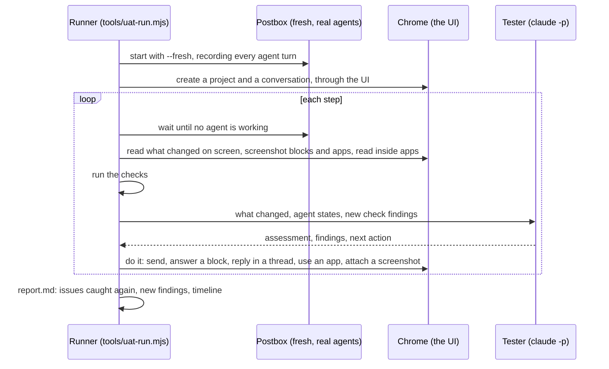

# End-to-end UAT

The component docs one level up check each part of the interface against the demo’s mock agent. This UAT checks the product as a whole: real agents, real data and a real browser, through a long piece of work, the way the defects in the issue tracker were found. A tester model plays the person, and deterministic checks run alongside it.

**It’s working when a run catches the defects already reported on GitHub.** Each report ends with a coverage table: which open issues the run caught again, and which ones a check watches for but didn’t see.

## How a run works



- **The driver** ([`tools/uat/driver.mjs`](../../../tools/uat/driver.mjs)) uses the UI the way a person does, with real clicks, key presses, typing and the file picker. It reads only what’s on screen, and reaches inside agent apps’ sandboxed frames to read and click them.
- **The tester** ([`tools/uat/tester.mjs`](../../../tools/uat/tester.mjs)) plays the person in the scenario. It sees each step’s changes, with screenshots, and judges them: broken UI, errors, anything hidden or unreadable, and agents doing the wrong thing. It picks the next action, and matches what it finds to open issues. It runs on your signed-in `claude` CLI, isolated from your own Claude Code settings.
- **The checks** ([`tools/uat/checks.mjs`](../../../tools/uat/checks.mjs)) catch defect classes deterministically from:
  - Postbox’s state and the page
  - every agent turn’s raw stream
  - the agents’ Claude Code transcripts
  - probes of the UI

## The checks, and what they reproduce

| Check                        | Issue | Looks for                                                                                                      |
| ---------------------------- | ----- | -------------------------------------------------------------------------------------------------------------- |
| fresh-install-agents         | #43   | A fresh install seeding use-case agents                                                                        |
| hidden-turn-error            | #61   | A failed turn whose error gives no reason                                                                      |
| refusal-without-card         | #65   | Calls Claude Code refused (the result’s `permission_denials`) with no card in the conversation                 |
| settings-leak                | #57   | The person’s output style, or a line of their global CLAUDE.md, in agent turns                                 |
| mcp-servers-missing          | #59   | The person’s MCP servers absent from the agents’ `init`                                                        |
| mcp-side-channel             | #54   | A Bash command posting to `/mcp?session=`                                                                      |
| prose-instead-of-block       | #63   | A turn ending in questions or numbered options, or a long draft, with no choice, form, review or confirm block |
| lint-on-person-term          | #55   | A lint turn defining a term the person wrote                                                                   |
| topic-relints-parent-term    | #56   | A topic thread re-defining its conversation’s terms                                                            |
| diagram-error-not-fed-back   | #46   | A diagram that failed to draw                                                                                  |
| app-shows-missing-data       | #47   | An app whose only content is a missing-data message                                                            |
| unreadable-app-marks         | #53   | Most SVG marks under 4 px, or labels under 9 px, inside an app                                                 |
| status-colors-for-categories | #52   | App code coloring with `--good`/`--alert` and none of `--s1`…`--s8`                                            |
| updated-app-far-up           | #49   | A new app version still far above the latest message                                                           |
| version-menu-overflow        | #36   | An app with 15 or more versions                                                                                |
| check-starved                | #37   | An app check that timed out                                                                                    |
| full-screen-noop             | #45   | Expand leaving the app frame the same size                                                                     |
| image-not-shown              | #48   | An attached image shown as a file chip                                                                         |
| review-table-raw             | #62   | A Markdown review block with a table                                                                           |
| stale-progress               | #58   | A progress step still running after its agent stopped                                                          |
| silent-while-working         | #68   | Agents thinking or calling tools with no working row on screen                                                 |
| model-not-shown              | #60   | No model name in the top bar                                                                                   |
| failed-turn, page-errors     | (new) | Any other failed turn, and console errors                                                                      |

When a defect is filed from a run, add a check for it here if it can be caught deterministically, so later runs keep watching for it.

## Scenarios

- [SciFact: claims, abstracts and retrieval](scenarios/scifact.md)
- [HotpotQA: renaming entities to test RAG memorization](scenarios/hotpotqa.md)

A scenario is Markdown:
- a title
- settings: the persona the tester plays, the agents, the project and the conversation’s name
- a summary
- one `## Phase` section per phase, in the person’s words

Each phase tells the tester what to ask for, what to expect, and which parts of the UI to exercise.

## Running it

```bash
node tools/uat-run.mjs --scenario scifact
```

Options:
- `--steps` (30 to 40 for a full run)
- `--turn-timeout` (seconds per agent turn, default 900)
- `--budget` (the tester’s spend cap, in dollars)
- `--tester-model`
- `--port`, `--chrome-port`, for two runs at once

A run needs Claude Code installed and signed in, Chrome, and network access for the agents’ data downloads. It uses real usage: a data-heavy agent turn can cost a few dollars.

Each run writes to `uat-runs/<time>-<scenario>/`, which git ignores:
- `report.md`: the issues caught again, new findings, and the timeline
- `findings.json`
- `run.log`
- `shots/`: screenshots of every block and app the tester saw
- `streams/`: each agent turn’s raw stream
- `data/`: Postbox’s data, so a run can be reopened with `node server/index.mjs --data uat-runs/<run>/data`

File what a run finds with the bug template in the [UAT README](../README.md), after checking each finding against its screenshot.

## Validation: 21 October 2026

The first two runs, on `main`, caught 14 of the issues already filed from real use. Each was confirmed against screenshots or the run’s saved data.

| Issue                                      | SciFact | HotpotQA | Caught by                                                                             |
| ------------------------------------------ | ------- | -------- | ------------------------------------------------------------------------------------- |
| #43 use-case agents on a fresh install     | ✓       | ✓        | check                                                                                 |
| #44 mixed fonts in apps                    | ✓       |          | check (two font stacks inside one app)                                                |
| #45 Expand isn’t full screen               | ✓       | ✓        | tester                                                                                |
| #48 images shown as file chips             | ✓       |          | check and tester                                                                      |
| #49 updated app stays far up               | ✓       |          | check and tester                                                                      |
| #53 chart labels too small to read         |         | ✓        | check (labels about 8 px)                                                             |
| #54 apps too large to send                 |         | ✓        | tester                                                                                |
| #55 lint on the person’s own term          |         | ✓        | check and tester                                                                      |
| #57 the person’s settings leak into agents | ✓       | ✓        | check and tester; an agent even published to the person’s own claude.ai artifact tool |
| #58 progress without time or staleness     |         | ✓        | tester                                                                                |
| #60 model not shown                        | ✓       | ✓        | check                                                                                 |
| #62 review tables as raw pipes             |         | ✓        | check and tester                                                                      |
| #63 questions and drafts in prose          | ✓       | ✓        | check and tester                                                                      |
| #68 nothing on screen while agents work    | ✓       | ✓        | check and tester                                                                      |

**Not triggered by these scenarios** (the checks watch for them):
- #46: no diagram failed to draw.
- #47: the agents embedded their data instead of loading it into the corpus.
- #52: the apps used the kit’s palettes.
- #56: no topic thread re-defined a term.
- #59: no MCP servers were configured on the machine.
- #61: every fork resumed.
- #65: nothing was refused.

A scenario that leans on those (a dataset too large to embed, permission-heavy work, a long topic thread) would exercise them. #50 and #51 need a hand-off from an app, which the tester didn’t make.

**What the runs found that wasn’t filed:**
- An unanswered review block keeps the agent “needs you” long after the conversation moved on.
- A review of 5 records shows 137 “Comment on line” buttons.
- Agents write `<details>` and expect it to fold, but Postbox shows agent HTML as text, and the guide doesn’t say so.

The tester also judged the agents’ work, catching a renaming that leaked identifying facts, and inconsistent counts between replies.

**What review found in the harness itself, all fixed before these numbers:**
- Sandboxed app frames couldn’t be reached.
- Item screenshots were offset, and blank beyond the window.
- KaTeX’s hidden screen-reader copy was read as garbled math.
- The tester wasn’t told when the run pressed Stop.
- The runner talked to whatever already held its port.

A run costs real usage: about $30 to $45 for agents, and $5 to $7 for the tester, over 30 to 70 minutes.

To apply improved checks to a finished run without running agents again:

```bash
node tools/uat-run.mjs --recheck uat-runs/<run>
```
