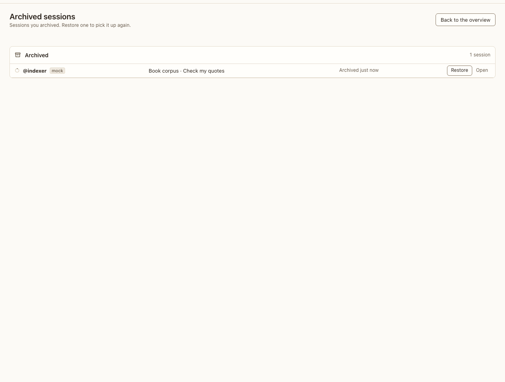

# Archived

**Where:** Archived in the rail, or #/archived.

## Why it exists

Archiving is the safe default for finished work; this is where it comes back from. Sessions pile up on the overview over time, many of them the same persona, so a finished conversation leaves it with its agents (#101).

## Expected functionality

- One row per conversation: the agents archived in it (its side threads’ forks too), project · conversation, and when they were archived. A conversation archived whole, one that sat idle as long as Settings › Projects says, and an agent archived on its own from its menu are all here.
- Archive keeps everything: the transcript, apps, files and the agent’s backend session, so Restore picks up where it left off. Nothing here is deleted on a timer; Delete conversation in the conversation’s ⋯ still works on an archived one.
- Restore brings back every agent the row lists, and the conversation returns to the overview and the sidebar. Open shows the conversation read-only.

## Steps to reproduce

1. Run the demo (`node tools/demo.mjs --port 4180`) and open <http://127.0.0.1:4180/> while it plays; keep the tab open.
2. On the overview, open an idle conversation’s ⋯ and choose Archive conversation.
3. In “Corpus planning”, open the top bar’s ⋯ and choose Archive room.
4. Open Archived from the sidebar, and restore both.

**Pass if:** Each conversation leaves the overview with all its agents, shows here as one row, and comes back whole on Restore.
